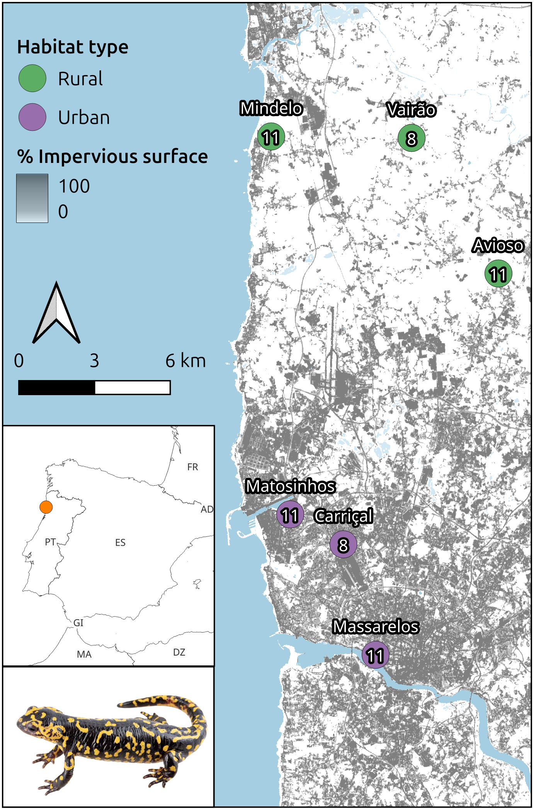
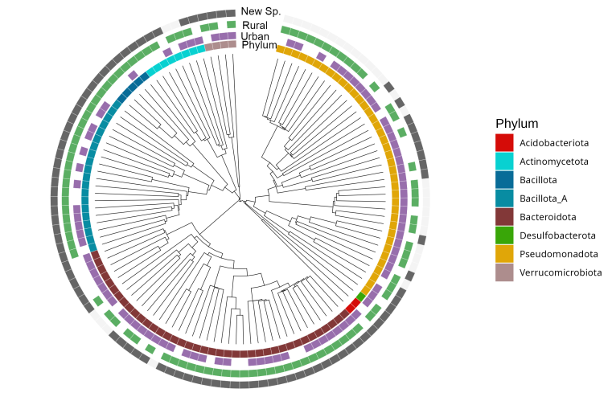

```{r knitr_opts, echo=FALSE}
knitr::opts_chunk$set(
    class.source = "script-source",
    class.output = "script-output",
    comment = NA,
    echo = FALSE)
```

# Abstract

While 16S amplicon sequencing has been used to good effect in characterizing microbial community composition, functional attributes of amphibian skin microbiomes have received less attention. Here we utilized genome-resolved metagenomics to assemble microbial genomes, profile microbial communities, and estimate their functional capabilities. Focussing on differences in the dermal microbiota of fire salamanders (*Salamandra salamandra*) across an urbanization gradient in northern Portugal, we aimed to examine variation among microbiome assemblages distinct environments at a local scale. Our findings suggest that urbanization corresponds to an increased abundance of microbiota phylum that are usually less abundant, specifically of taxa within the class Bacteroidia, and a corresponding decline in the otherwise predominant class Gammaproteobacteria. Significant differences in the inferred functionality associations of either bacterial class warrants further investigation into the environmental conditions that drive these changes and the implications for the host.

# Introduction

#### Amphibians in decline

Amphibians are occasionally referred to as metaphorical "canaries in the coal mine" for global biodiversity loss [@morell_frogs_1999; @norris_ghosts_2007], as they are the most vulnerable vertebrate group faced with multiple anthropogenic threats, many of which may co-occur or compound [@luedtke_ongoing_2023]. Recent research into amphibian declines [@crawford-ash2025], particularly in Europe, Australia, and the Americas, have focused on the spread of fungal chytrid pathogens [@ohanlon_recent_2018; @rollins-smith_batrachochytrium_2021; @castro_monzon_batrachochytrium_2022], *Batrachochytrium dendrobatidis* (Bd, @longcore_batrachochytrium_1999) and *Batrachochytrium salamandrivorans* (Bsal, @martel_batrachochytrium_2013), which have resulted in catastrophic mortality events among naive amphibian populations [@skerratt_spread_2007; @lips_overview_2016, @fisher_chytrid_2020; @erens_divergent_2023]. Despite these conspicuous mortality events, however, the leading cause of amphibians’ declines remains habitat loss and degradation, primarily through agriculture and urbanization [@luedtke_ongoing_2023]. Anthropogenic land use causes disturbances that are found to negatively impact amphibian fitness and species richness [@macdonald2023; @iglesias-carrasco2017].

#### Habitat degredation

Urbanization in particular, dramatically changes habitat structures and increases the intensity of environmental stressors, including changes in hydrology, temperature, and connectivity [@hamer_amphibian_2008; @scheffers_effects_2012; @barrett_urbanization_2014; @yang_global_2022]. Amphibian residents within urban habitats often display a reduction in body condition and fitness when compared to rural populations [@iglesias-carrasco_urban_2017; @jennette2019]. The impact of urbanization, however, is often elusive, as cities may also entail some potential benefits, as urban green spaces may provide refuges for wildlife species [@clevenot_review_2018; @schmidt_population_2021; @gentili_urban_2024] further complicating our understanding of how habitat changes impact local wildlife. Increasingly, the microbial composition of urban soil and water has also become the subject of study as it is prone to contamination from proximity to industrial and agricultural pollution [@cachada_levels_2012; @coban2022; @liu2025]. For terrestrial amphibians, soil quality is especially important as it functions as the vector though which amphibians are exposed to pollutants [@dong2024; @purucker2023] and the microbiota that colonize the dermis [@walke2014; @barnes_assembly_2021; @loudon2013].

#### Importance of amphibian dermis

The amphibians, perhaps more than any other characteristic, have received a great deal of study and attention. Considered one of the earliest adaptations among vertebrates to terrestrial life, amphibians have a thin, permeable skin that allows for gas and water exchange [@akatçömden2023]. Amphibians' skin comprises most of their respiratory capillaries and can almost completely provide respiration [@tattersall2007]; however, this increased permeability comes at the expense of increased water loss [@toledo1993] and vulnerability to xenobiotics [@kaufmann2016; @quaranta2009] and pollutants [@purucker2023]. To maintain hydration and skin health, amphibians have glands such as aquaglyceroporins that allow for the uptake of water through the dermis and mucosal glands that produce mucosins and mucopolysaccharides to retain moisture and protect the dermis [@demori_peptide_2019; @pereira2018]. Some amphibian species, such as the fires salamander (*Salamandra salamandra*), have also evolved specialized glands that produce poison (e.g. samandarines) as a chemical defence to deter predators [@luddecke_salamanders_2018]. These compounds have been used in as medicines and poisons, but they can also be detrimental to the host in excess. The dermis is also where stress responses can be detected [@santymire2018] and serves as an important indicator of individuals' health.

#### Microbiota as part of a healthy dermis

Given the importance of amphibians' dermis to individual health, much attention has been directed toward understanding the role that dermal microbiota have in maintaining dermis health and function [@hernández-gómez2023]. Specifically, to understand the pathology of *Bsal* and *Bd* [@van_rooij_amphibian_2015], many studies have examined the role that dermal microbiota have in amphibians' ability to resist fungal infections [@muletz-wolz_inhibition_2017; @le_sage_preparatory_2021; @gonzalez-serrano_amphibian_2025]. Repeatedly, results suggest that alterations to microbial communities increased susceptibility to pathogens [@becker2010; @bletz_disruption_2018] and contributed to the formation of lesions [@zhu2024; @luddecke_salamanders_2018]. While amphibians' skin microbiota have received much attention, amphibians regularly shed their epidermis, in a process called sloughing [@ohmer2015], as part of a healthy turnover of skin but which also results in a very low abundance of microbiota [@bletz_disruption_2018]. Subsequently, while amphibian skin microbiomes are an essential part of dermal function, they are very susceptible to disturbances [@jani_amphibian_2021; @bates_captivity_2019]. Further examinations of environmental impacts on amphibian microbiota assemblages have reported that many factors, such as local plant communities [@hernández-gómez2020] and pollution [@dong2024] can impact the dermal microbiome.

#### Amphibian microbiota through 16S

To date, the majority of studies that have characterized amphibian microbiota have done so through sequencing of the 16S rRNA marker gene [@barnes_assembly_2021; @santos_skin_2023; @muletz_wolz_effects_2018; @afonso_effects_2022]. Metabarcoding through amplicon enrichment utilizes existing microbial databases to identify the taxonomy of prokaryotes in a manner that is generally accessible and replicable [@pruesse_silva_2007; @quast_silva_2013]. While suited for taxonomic identification of prokaryote taxa, amplicon sequencing can result in a coarse taxonomic resolution and cannot capture any of the functional variation which may occur within microbiome communities [@campanaro_taxonomy_2018; @durazzi_comparison_2021]. While indirect methods to infer functional features of microbiomes from 16S sequences exist [@barberan_exploration_2012], these rely on genomes recorded in public databases, which are largely biased towards humans and other model taxa. These databases of have limited representation of amphibian-associated microbes which, despite similar 16S sequences, might carry significantly different functional attributes [@sun_inference-based_2020; @callahan_exact_2017].

#### Challenges and advantages of metagenomics

In this study, we have chosen instead to use genome-resolved metagenomics, where random short-read DNA sequences are used to assemble microbial genomes [@weinstock_genomic_2012; @quince_shotgun_2017], upon which community-level microbiome inferences are built. This alternative approach was considered preferable to 16S amplicon sequencing as larger sequence assemblies can improve taxonomic resolution [@ziesemer_intrinsic_2015; @durazzi_comparison_2021] and capture functional gene information within coding regions of the microbial genomes [@bates_microbiome_2022; @eisenhofer_impact_2023]. Additionally, because this methodology does not rely on primer based enrichment, which may result in biased representation-targeting bacterial genome sequences, the relative abundance of taxa are better preserved [@gloor_microbiome_2017]. The compromise with this approach, however, is that host DNA will inevitably be sequenced and will comprise the majority of the sequence reads [@pereira-marques_impact_2019]. Removing host DNA generally entails mappings reads to a reference, which in the case of amphibians are often unavailable or difficult to construct owing to the often large size and complexity of amphibian genomes [@sun_slow_2012; @liedtke_macroevolutionary_2018]. Our aim, in this study, however, is to demonstrate that despite these challenges' microbiome genomic diversity from amphibians can be captured and applied at a local scale.

#### Introducing our study system

To demonstrate the benefits of applying a metagenomic approach, we sought to characterize the differences in amphibian gut microbiomes between habitats. Our focal species for this study are fire salamanders (*Salamandra salamandra*; Linnaeus 1758) sampled from within and around the city of Porto, Portugal. Fire salamanders are a widely dispersed and abundant amphibian species, typically associated with forest biomes, and (at least within this study region) have a biphasic life cycle that depends on temporary water bodies for larval development [@wagner_habitat_2020; @velo-anton_salamandra_2015]. Salamanders have also been reported in a variety of urban green spaces throughout their species range and can be considered tolerant to urban habitats [@guilherme_porto_2015; @lourenco_trapped_2017; @iglesias-carrasco_urban_2017; @marques_coi_2022]. Salamander microbiomes have become the subject of increased focus following outbreaks of *Bsal* in central Europe [@castro_monzon_batrachochytrium_2022], providing us with a point of comparison to conventional 16S studies. To our knowledge fire salamanders have thus far only ever been subject to 16S amplicon sequencing, and while characterization of the microbiome at variable life stages and habitats are available [@sanchez_cutaneous_2017; @bletz_disruption_2018; @afonso_effects_2022], they miss out on the more detailed taxonomic and functional resolution that shotgun sequencing provides [@antony-babu_multiple_2017].

Our aim in this study has been to characterize the fire salamander dermal microbiome and examine changes in composition and functionality between urban and rural habitats. Several sites from within the urban core of the city and outside along the rural periphery were sampled. Shotgun-sequencing was then used to assemble microbiota genomes and compared for differences in relative abundance and functional characteristics. Urban habitats are characterized by environmental distributions and perturbations to microbial communities [@mckinney_urbanization_2006; @zhou_urbanization_2023; @zheng_urbanization_2025]. Comparisons of skin microbiota among amphibian species, have reported that urbanization corresponds to increased homogeneity among urban populations, but not necessarily decreases in taxonomic richness or diversity [@barnes_assembly_2021; @basanta_genetic_2022; @zhou_urbanization_2023; @touceda-suarez_differences_2025; @wheeler_effects_2025] as repeated disturbances may disrupt community connections providing openings for colonization [@hu_impervious_2018]. We therefore hypothesized that microbiome assemblages would vary between urban and rural sites, while not necessarily correlating to differences in species richness or diversity. This pattern should remain consistent with results from amplicon enrichment, however, will include more reliable reports on the relative abundances of microbiota and the differences in functional association.

# Methods

### Sampling

The city of Porto, Portugal, is a large urban matrix comprised of isolated urban parks of varying size, extensive forested areas comprised of either endemic and invasive tree species, and many small agricultural plots intersecting them [@guilherme_looking_2022]. Sites were generalized as either urban or rural based on their proximity to the urban metripolitan core of the city [@madureira_green_2011]. Urban sites were small semi-forested plots (\~9 ha) surrounded by areas of high impervious surface, such as roads and built structures. Rural sites, by contrast were large areas (27-39 ha) with extensive tree cover and surrounded by agricultural or forested plots. Individuals were collected between mid October to early November of 2023, on nights of high humidity and when temperatures range from 14-22 ºC. This coincides with a season of peak activity when males, distinguished by the presence of an enlarged cloaca, move above the leaf litter and present themselves as mating candidates [@velo-anton_salamandra_2015]. Using sterile gloves, specimens were collected and placed in small individualized sterile containers, ideally avoiding direct contact, instead scooping them into the containers to minimize contact with the dermis. Salamanders were then moved to laboratory facilities at Research Centre in Biodiversity and Genetic Resources (CIBIO) in Vairão, Portugal, the following morning to proceed with swabbing. During swabbing a technician wearing sterile gloves (replace between samples) restrained individual salamanders by the base of the tail, using sterile paper towel to help maintain a grip. Individual were then sprayed thoroughly with distilled H~2~O to remove debris. Once rinsed, the individual dermis was swabbed with ten stokes on the dorsal, ventral, and each lateral side with a swab and placed in a 2 mL tube pre-filled with PBS buffer and frozen at -20ºC. After swabbing individuals were returned to the sampled location later the same day.

```{r,  warning=FALSE, comments="", message=FALSE, eval=FALSE, echo=FALSE}
library(dplyr)
library(tinytable)
type_of_test <- c('T-test','F-test','Regression')
small <- c(.2, .1, .02)
medium <- c(.5, .25, .15)
large <- c(.8, .4, .35)
data.frame(type_of_test,small,medium,large)  %>% 
  tt()
# expected effect size
k = 2
f = NULL
n = 30
sig.level = 0.05
power = 0.85
# t test comparison between two groups
pwr::pwr.t.test(n = 30,
                sig.level = sig.level,
                power = power)
```

### Sequencing

Samples were processed in October 2024 at the Globe Institute’s (University of Copenhagen) molecular laboratory in Copenhagen, Denmark, following the established EHI laboratory protocols available at www.earthhologenome.org/laboratory [@pietroni_hologenomic_2025]. Samples underwent bead-beating before DNA isolation employing silica magnetic beads with solid-phase reversible immobilization. The concentration of DNA extracts was quantified using a Qubit™ 3 Fluorometer (Thermo Fisher Scientific, USA). DNA was fragmented into approximately 450 bp-long fragments using a Covaris LE220 platform. Library preparation followed the ligation-based BEST protocol [@caroe_single-tube_2018], utilizing a standard input of 200 ng of DNA in 24 µl or the closest amount feasible based on the sample DNA concentration. We used 1.5 µl of 20 µM adaptors for a 50-200 ng DNA input, 1.5 µl of 10 µM for 10-50 ng, 1.5 µl of 5 µM for \<10 ng, and 1.5 µl of 2 µM for samples below the quantification range of the Qubit® dsDNA HS (High Sensitivity) Assay Kits. Libraries underwent qPCR screening to determine the optimal number of library indexing PCR cycles [@murray_benchtop_2015], followed by PCR amplification using unique dual index primers with an adjusted number of cycles ranging from X~1~-X~2~. The resulting libraries underwent automated capillary electrophoresis (Bioanalyzer or Fragment Analyzer) for assessment of fragment-length distribution, adaptor dimers, and adaptor-to-library molar ratios. Finally, samples were pooled into multiple sequencing batches, and sequencing was performed across multiple lanes of NovaSeq6000 and NovaSeq X platforms (Illumina, USA), generating \_\_\_ GB (approximately \_\_\_ million reads) of 150 bp paired-end sequencing data per sample.

### Bioinformatics

Raw metagenomic reads were processed following the bioinformatic workflow outlined by the Earth Hologenome Initiative (see @leonard_global_2024; <https://www.earthhologenome.org/>), and stored in the Electronic Research Data Archive (ERDA) of the University of Copenhagen. Computation was conducted in the local cluster of the Globe Institute (Mjolnir) using the snakemake- and slurm-based bioinformatic pipelines tailored to the platform (<https://github.com/earthhologenome/EHI_bioinformatics/tree/mjolnir>). Quality filtering to remove adapters, low-quality reads (phred \>= 20), short reads (\>= 60 bp), and polyG/polyX tails was done with Fastp v.0.23.4 [@chen_fastp_2018]. With skin swabs, the majority of DNA extracted is expected to belong to the host, and so the proportion of prokaryotic sequences were estimated using SingleM microbial fraction [@eisenhofer_quantifying_2024]. Host-derived reads were removed by mapping against a reference host genome using Bowtie2 v.2.5.1 [@langmead_fast_2012] and Samtools v.1.18 [@danecek_twelve_2021]. In the absence of a reference genome for *S. salamandra*, we used a *Salamandra salamandra* transcriptome (NCBI RefSeq HBZU010000000; @libro_novo_2023) in addition to the reference genome of *Pleurodeles waltl* (NCBI RefSeq assembly GCF_031143425.1; @brown_chromosome-scale_2025), which was the most phylogenetically related species with a reference genome available at the time [@zhang_phylogeny_2008]. Unmapped metagenomic reads were assembled into contigs then into putative bacterial genomes known as *metagenome-assembled genomes (MAGs)* by MEGAHIT v.1.2.9 [@li_megahit_2016]. The quality of these MAGs for subsequent downstream analyses was evaluated with Quast [@gurevich_quast_2013] and contig coverage was determined by CoverM [@aroney_coverm_2025]. Metagenomic binning was performed by multiple algorithms, including CONCOCT v.1.1 [@alneberg_binning_2014], MetaBAT2 v.1.7 [@kang_metabat_2019], and MaxBin2 v.2.2.4 [@wu_maxbin_2016], the refined by MetaWRAP [@uritskiy_metawrapflexible_2018] into consensus bins. Taxonomical annotations of MAGs were matched to the Genome Taxonomy Database (GTDB) with the taxonomic classification toolkit (GTDB-Tk) [@chaumeil_gtdb-tk_2022; @parks_gtdb_2022]. Genome-Inferred Functional Traits (GIFTs) of MAGs were assigned with DRAM [@shaffer_dram_2020] using the Pfam [@finn_pfam_2016], KEGG [@kanehisa_kegg_2017], UniProt [@mcgarvey_uniprot_2019], CAZY [@cantarel_carbohydrate-active_2009], and MEROPS [@rawlings_merops_1999] databases and distillR (available at <https://github.com/anttonalberdi/distillR>). An average nucleotide identity (ANI) of 98% and a minimum genome completeness of 50% were used to dereplicate highly similar MAGs using dRep [@olm_drep_2017]. Reads were then mapped to a MAG catalogue to extract quantitative read-abundance information to calculate relative abundance of each MAG per sample, retaining only those with completeness values above 50% and contamination levels below 10% [@bowers_minimum_2017].

### Statistics

For each sample, we determined the proportion of sequenced bases that were mapped to MAGs as compared to those that were filtered due to poor quality, unmapped, or mapped to the host. The domain-adjusted mapping rate (DAMR) was used to quantify microbial genome recovery from metagenomes, calculated as the rate of read mapping to sets of microbial genomes (MAGs or other references) divided by the fraction of the community predicted to be prokaryote [@eisenhofer_quantifying_2024]. Differences in the proportion of mapped bases between habitats was determined through a Wilcox rank test [@bauer_constructing_1972]. The relative abundance of each MAG was determined as the number of assigned reads as a proportion of the MAGs' length, divided by average read length [@gloor_compositional_2016; @gloor_microbiome_2017], with a Tukey's Honest Significant Difference test (TukeyHSD, @tukey_problem_1953) to identify significant differences in relative abundance between habitats at the phylum, class, and family taxonomic scale.

Differences in MAG richness as well as neutral, phylogenetic, and functional beta diversities were calculated with Hill numbers [@hill_diversity_1973; @chao_unifying_2014] using Hilldiv2 v.2.0.2 [@alberdi_hilldiv2_2025]. Neutral diversity represent species diversity without considering the degree of relatedness among MAGs, phylogenetic diversity incorporate branch-length information of the phylogenetic tree of the MAGs, and functional diversity consider functional differences among MAGs [@hernandez_contrasting_2024]. Differences in richness and diversity estimates between habitats and or/sites were determined with the betadisper function in vegan v.2.6-10 [@oksanen_package_2013]. A permutational multivariate analysis of variance (PERMANOVA) was performed to test for differences in microbial composition between habitats using the adonis2 function in vegan. Once again, Wilcoxon rank sum test was used to test for differences in the variance within each group when comparing habitats and an analysis of variance (ANOVA; @chambers_statistical_1992) was used to compare differences in variance between sites.

For each MAG, GIFTs were aggregated to a singular GIFT value for each functional element, then aggregated to genome specific GIFTs for each individual using the *to.element* and *to.community* functions included in distillR. Excluding GIFT elements with less than an average 0.1 association among all individuals, a Wilcoxon rank sum test was used to determine if there were differences in GIFTs between habitats and, whenever present, habitat specific bacterial clades.

All statistical analyses were performed using the R software v.4.5.0 (R Core Team, 2025).

# Results

From each sites, up to 11 samples were collected when possible, with thirty samples collected from each habitat (Figure 1). Sequencing libraries included a total of 60 swabs used to generate approximately 105M total reads (mean ± SD = 1.75 ± 2.69, median = 1.11, M reads per sample) of short-read DNA sequencing data. Quality filtering and host read removal resulted in 98.5M filtered reads (mean ± SD = 1.69 ± 2.68 , median = 0.991, Gb per sample) of metagenomic data, assembled into 118 metagenome-assembled genomes (MAGs) that passed our minimum quality criteria (CheckM2 estimated completeness \>50%, contamination \<10%). A mean of 4.42 ± 1.89 Gbases were generated per sample, with an average 5.8% mapped to MAGs, while 5.3% were removed for low quality, and the remaaining either unmapped or mapped to the host. Average MAG completeness was 79.3 ± 16.1 %, and contamination 2.75 ± 2.42 %. The mean DAMR suggest that 22.5 ± 20.8 % of bacterial reads were successfully mapped to MAGs. Between the two habitats, a significantly lower proportion of bases were assigned to MAGs among urban samples as compared to rural samples (W = 646, p = 0.003).



Among the 118 distinct MAGs, the three most taxa rich phyla were Bacteroidota (33.1%), Pseudomonadota (33.1%), and Bacillota (21.2%)(Table 2; Figure 2). With the exception of Pseudomonadota, the majority of MAGs (73.7%) were identified as new species, with a total of 87 MAGs lacking species level annotations and a further 19 MAGs lacked genus level annotations. Among families with more than a single ascribed taxa, two, Erysipelotrichaceae (phylum Bacillota; 3 MAGs) and Pseudonocardiaceae (phylum Actinomycetota; 3 MAGs), were exclusive to rural habitats, and another two, Chitinophagaceae (phylum Bacteroidota; 5 MAGs) and Steroidobacteraceae (phylum Pseudomonadota, 2 MAGs), were exclusive to urban habitats.

Table 2. For each observed prokaryptic phylum, the number of distinct MAGs assembled, the proportion of MAGs assigned to that phylum, and the number of distinct classes, orders, and families in each, and the proportion of MAGs identified as new species.

| phylum            | MAGs | \% MAGs | Classes | Orders | Families | \% new species |
|-------------------|-----:|--------:|--------:|-------:|---------:|---------------:|
| Acidobacteriota   |    2 |    1.70 |       1 |      2 |        2 |           1.00 |
| Actinomycetota    |    8 |    6.80 |       1 |      2 |        6 |           0.75 |
| Bacillota         |   25 |    21.2 |       2 |      5 |       10 |           1.00 |
| Bacteroidota      |   39 |   33.00 |       1 |      4 |       10 |           0.90 |
| Desulfobacterota  |    1 |    0.85 |       1 |      1 |        1 |           1.00 |
| Pseudomonadota    |   39 |   33.00 |       2 |     12 |       16 |           0.36 |
| Verrucomicrobiota |    4 |    3.40 |       2 |      2 |        2 |           1.00 |



Pseudomonadota was by far the most abundant phylum represented followed distantly by Bacteroidota (Table 3). Bacteroidota had a greater relative abundance among urban individuals and conversely, Pseudomonadota were more abundant among rural individuals. Increasing the taxonomic resolution to class, we identified that these differences correspond specifically to differences between Bacteroidia and Gammaproteobacteria (Figure 3), and furthermore the genus *Acinetobacter* (delta = 0.19, p \< 0.001) within the latter.

```{r,  warning=FALSE, comments="", message=FALSE, eval=FALSE, echo=FALSE}
df = readRDS("Ssal_Microbiota/figure/table_relative_abundance.RDS")
df[order(df$overall,decreasing = T),]
```

Table 3. For each phylum, the total relative abundance (*A*) as well as relative abundance within either urban or rural habitats reflects the proportion of sequence reads from sampled individuals. Significant differences in relative abundance between habitats were tested for each phylum.

| phylum            | *A*~total~ | *A*~urban~ | *A*~rural~ | p      |
|-------------------|-----------:|-----------:|-----------:|:-------|
| Pseudomonadota    |     0.7514 |     0.6946 |     0.8082 | 0.0379 |
| Bacteroidota      |     0.1322 |     0.1970 |     0.0673 | 0.0064 |
| Acidobacteriota   |     0.0869 |     0.0065 |     0.0023 |        |
| Bacillota         |     0.0202 |     0.0099 |     0.0306 |        |
| Actinomycetota    |     0.0044 |     0.0870 |     0.0867 |        |
| Verrucomicrobiota |     0.0044 |     0.0044 |     0.0043 |        |
| Desulfobacterota  |     0.0005 |     0.0005 |     0.0005 |        |


No significant differences in either species richness, neutral diversity, phylogentic diversity, or functional diversity estimates were observed (Figure 4A-D). An analysis of variance comparing each of the aforementioned metrics between sites also failed to identify significant differences between them. When comparing diversity between habitats, however, significant differences were observed between urban and rural individuals among all the aformentioned metrics (Figure 4E-H). Within each of the habitats, significant differences in neutral diversity estimates were observed among sites from either habitat (Figure S1B,F) and in phylogenetic variation exclusively among urban sites (Figure S1G).


Aggregating functional association among microbial communities form either habitat, no significant differences in mean GIFT assemblages were observed. The functional elements with the highest probability of association were related to biosynthesis of amino-acids, nucleic acids, organic anions, short-chain fatty acids, and the degradation of sugars (Figure S2). Focusing on MAGs included within the classes Gammaproteobacteria and Bacteroidia, which differed significantly in their relative abundance between habitats (Figure 3), we identified twelve functional elements that varied in their probability of association between the classes (Figure 5). These functional elements included the biosynthesis of menaquinone and ubiquinone; the degradation of benzoate, catechol, fatty acids, galactose, napthalene, penicillin, and triglycerides; and microbial structural formations of pilus.


# Discussion

In line with out initial hypothesis, urbanization did not corresponds to a change in microbiota diversity (Figure 4A-D), but rather a shift in microbiome assemblage between habitats (Figure 4E-H). More specifically an increased relative abundance among Bacteroidia and a corresponding decline in Gammaproteobacteria (Figure 3). While our hypothesis that urbanization would result in greater taxonomic and functional variance among sites was not supported, differences in the inferred functional elements were observed between habitats (Figure 5). Based on our results we have concluded that habituation in urbanized habitats results in the increased abundance of Bacteroidia among the microbiota of fire salamanders, which may consequential influence microbiota functionality.

### Variance across habitat

Similar to other characterizations of amphibian dermal microbiota, diversity among fire salamanders is not necessarily reduced among urban habitats but instead varies in composition [@barnes_assembly_2021; @walke_seasonal_2021]. All observed phyla were detected in either habitat, and among the few cases where a taxonomic family was exclusive to a habitat, as was the case with Chitinophagaceae among urban habitats and Pseudonocardiaceae and Erysipelotrichaceae among rural habitats, they were nominally represented in regards to relative abundance, contributing no more than 2% of the total reads. Rather, differences between habitats were driven by the relative abundance of Gammaproteobacteria and Bacteroidia, and furthermore an increased phylogenetic diversity between urban sites. This is in line with studies of urban soil microbiomes, which reported greater phylogenetic diversity among urban sites [@zhou_urbanization_2023; @touceda-suarez_differences_2025], including results from @barnes_assembly_2021 which similarly reported that among *Plethodon cinereus*, that relative abundance of Acidobacteriota and Bacteroidota increase in correlation with urbanization. Changes in microbial assemblages of the environment may occur through translocation or deposition of soils between urban sites or through pollution [@cachada_levels_2012; @touceda-suarez_differences_2025]. While amphibians' dermal microbiomes are generally distinct from from their environments [@burgon_phylogenomic_2021; @bletz_host_2017], their environment represents a reservoir for exposure to microbiota taxa [@muletz_soil_2012]. A network analysis of urban soil microbiota in Chengdu, China by @zhou_urbanization_2023 reported that soil in urbanized sites were more phylogenetically diverse but subsequently had lower taxonomic co-occurrence compared to rural sites, and more vulnerable to community assemblage and function changes following from stochastic events. With greater phenotypic variation between sites, more evenly distributed relative abundance of taxa, and lower sequence output from urban salamander microbiomes, the characterization of urban salamander microbiota appears consistent with a microbial community that reduced taxonomic redundancy and susceptible to stochastic disturbance.

### Methodological benefits

Comparing the application of shotgun sequencing in this study to previously reported results from other studies using 16S aplicon sequencing of the fire salamander dermal microbiome, both suggest a similar microbiome assemblage where Pseudomonadota has been identified as among the most taxa rich and abundant phylum, followed by Bacteroidota [@afonso_effects_2022; @barnes_assembly_2021; @bletz_host_2017; @bletz_disruption_2018]. Unlike many of those studies, however, Bacillota and Bacteroidota were identified as similarly taxonomic rich phylum. This may reflect that unlike Pseudomonadota, that MAGs ascribed to these phylum have comparatively few existing taxonomic references. While studies utilizing 16S amplicon sequences also report relative abundance, this measure is generated through statistical simulation or inferences to correct for enrichment bias [@mandal_analysis_2015; @kurtz_sparse_2015]. Electron microscopy and qPCR of fire salamanders' dermis have revealed low microbial abundances along the skins surface [@bletz_disruption_2018] and with less starting genetic material, the number of enrichment cycles required for suitable detection 16S fragments increases (30-35 cycles) as does the subsequent risk of initial enrichment bias [@nearing_identifying_2021; @silverman_measuring_2019]. Shotgun sequencing, by not relying on abundant enrichment cycles (3-10 cycles), therefore does not need to infer relative abundance and is less susceptible to starting material biases.

The greatest logistical challenge of this approach, particularly when applied to amphibians, was the presence of a large complex host genome which required prior filtering to separate host from bacterial DNA [@eisenhofer_quantifying_2024]. We were able to assign an average of 5.8% of reads per sample to bacterial genomes and despite excluding the majority of reads, were able to construct 118 bacterial genomes, the majority of which lack prior taxonomic references. With an average genome size of 3.9Mb corresponding to estimated 78.5% completeness, we wish to highlight that with even a small fraction of sequence reads, it is possible to generate comprehensive bacterial genome assemblies. Additionally, while not included in this study, the majority of reads attributed to the fire salamander genome are available for subsequent analysis of host genomics and will be a valuable contribution to amphibian genomic development [@pietroni_hologenomic_2025; @kosch_amphibian_2024].

### Functional elements

A further benefit of implementing a shotgun sequencing approach is our ability to predict microbiome functionality. Among similarly related taxa, functionality can vary and will not be captured by 16S sequencing unless the taxa in question have already been functionally characterized [@cevallos_genomic_2022]. Prior studies comparing 16S community composition to functional gene characterizations have found inconsistent associations between the two [@barberan_exploration_2012]. Shotgun sequencing, by capturing full genes, can then use GIFTs rather than by taxonomic inference, which would be especially fraught given the high number of taxa described in this study without prior taxonomic references.

Much of the work on microbiome functionality among amphibians, and in particular fire salamanders, have been to determine the role that microbiota have in conferring resistance to chytrid fugal implications [@bletz_disruption_2018; @bates_captivity_2019; @crawshaw_widespread_2022; @smith_skin_2018; @kueneman_effects_2022]. Among the microbiome communities, the genera *Stenotrophomonas, Chryseobacterium*, and *Pseudomonas* have all been proposed as *Bsal* inhibitors [@hoyt_bacteria_2015], of which the lattermost was on average the most abundant genus among our samples. The relative abundance of *Pseudomonas,* however, did not vary significantly between habitats. Rather the only individual genus that differed significantly between habitats, being more abundant among our rural samples, was *Acinetobacter*, which has also been associated with inhibiting *Bsal* and *Bd* growth [@muletz-wolz_inhibition_2017; @cevallos_genomic_2022].

While comparing the functionality of microbiome assemblages as an aggregate, no significant differences between habitats were observed. Those functional elements that had the greatest probability of association with a functional trait were associated with biosynthesis and degradation of amino-acids and sugars, and likely represent the portions of the microbial genomes associated with cellular function. Instead, we focused on the the significant difference in functionality between Gammaproteobacteria and Bacteroidia given how these represent the two groups with clear differences in relative abundances between habitats. The majority of functional elements that differed between these classes were associated with degradation, specifically the degradation of lipids and sugars (triglycerides, fatty acids, and galactose); xenobiotic materials (catechol, benzoate, and napthalene); and antibiotic degradation. Interestingly, bacteroidia function was found to be more likely associated with degradation of penicillin, a common anti-bacterial compound, and which has been reported as a recurring pollutant in urban waste water [@halling-sorensen_occurrence_1998] and reduces larval amphibian activity and body condition [@villatoro-castaneda_exposure_2023]. In regards to biosynthesis, the greatest differences between classes are between synthesis of ubiquinone, menaquinone, and to a lesser extent pyocuanin. A study of Chinese fire-bellied newts identified several proteins, including ubiquinones, which were hypothesized to influence the rate of mitochondrial oxygen (O~2~) generation[@sun_proteomic_2016; @lass_mitochondrial_1997]. Menaquinone, otherwise known as vitamin-K, also plays a part in anaerobic growth [@sharma_menaquinone_1992] with potential relevance toward inhibiting *Bd* growth [@velasquez_microbial_2025]. Structural differences in bacterial motility [@philip_mapping_2025], specifically the development of pillus, are expected as Bacteroidia are generally characterized by an evolutionary loss of motility [@mcbride_bacteroidetes_2019].

### Conclusion

Urbanization has an apparent influence on the relative abundance of microbial taxa communities of the fire salamander dermis. From previous studies and our own evaluation of rural samples, the fire salamander dermal microbiome is predominantly comprised of Pseudomonadota, and more specifically the genus *Psedomonas*. Urbanization appears to have the effect of altering the relative abundance of microbial taxa, specifically the increase abundance of secondary bacterial groups, that otherwise occur in low relative abundances. Given the role of *Psedomonas* as a dominant taxa and its association with fungal resistance, further study is recommended to compare these impact that altered bacterial colonies have on dermal health, and whether these changes better reflect variation in the microbial composition of the habitat or a response to an as of yet defined environmental pressure.

# Acknowledgements

Thanks to Carlos Caballero-Díaz for assistance with sampling, to Isolde van Riemsdijk for consulting on sampling best practices.

This publication was funded through the generous support of the Fundação para a Ciência e a Tecnologia (FCT) as part of the project "ANTHROPHIBIANS: adaptive genomic and microbiotic responses of amphibians in anthropogenic landscapes" (2021.05570.BD; <https://doi.org/10.54499/2021.05570.BD>).

### Data accessibility

The raw data tables containing the quantitative information and bioinformatic code scripts used for the analysis are available in a dedicated GitHub repository, both rendered into a html webbook (XXXXXXXX) and frozen in Zenodo with Doi: XXXXXXXXX. Raw sequencing data and microbial genome sequences, have been or will be published as part of the 2nd EHI Data Release, under the Bioproject PRJEB77033.

# Supplementary Materials


# Bibliography
