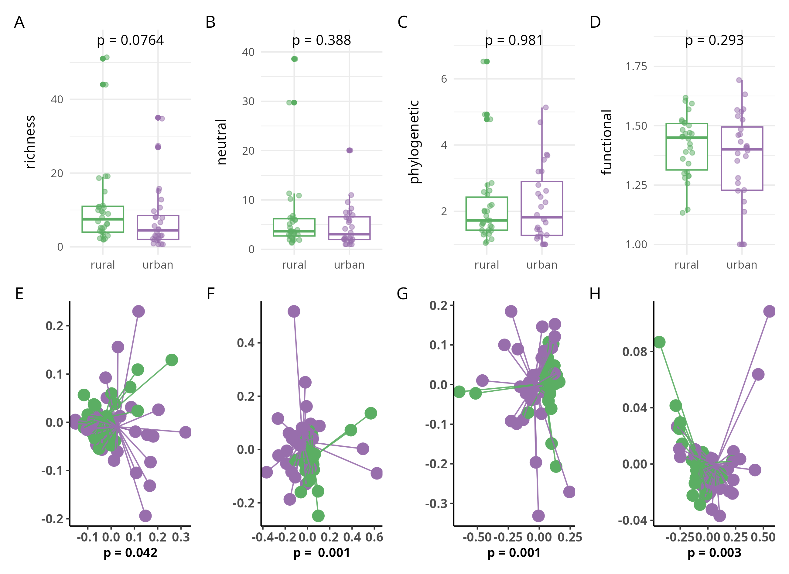
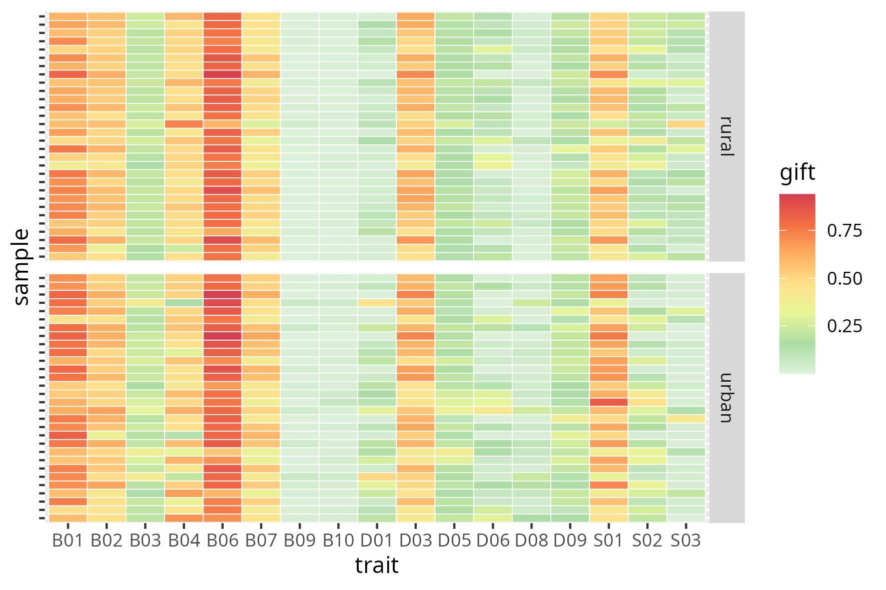

```{r knitr_opts, echo=FALSE}
knitr::opts_chunk$set(
    class.source = "script-source",
    class.output = "script-output",
    comment = NA,
    echo = FALSE)
```

^1^ Departamento de Biologia, Faculdade de Ciências, Universidade do Porto, 4099-002 Porto, Portugal

^2^ CIBIO, Centro de Investigação em Biodiversidade e Recursos Genéticos, InBIO Laboratório Associado, Campus de Vairão, Universidade do Porto, 4485-661 Vairão, Portugal

^3^ BIOPOLIS Program in Genomics, Biodiversity and Land Planning, CIBIO, Campus de Vairão, 4485-661 Vairão, Portugal

^4^ Center for Evolutionary Hologenomics / GLOBE Institute, University of Copenhagen, 1353 Copenhagen K, Denmark

⁵ Universidad de Vigo, ECOEVO Lab, EE Forestal, Campus Universitario A Xunqueira, E-36005, Pontevedra, Spain

AJDM (ORCID: 0000-0002-6070-0506); NG (ORCID: 0009-0002-3068-4653); GVA (ORCID: 0000-0002-9483-5695); AA (ORCID: 0000-0002-2875-6446)

\newpage

# Abstract

The dermis is an essential organ for respiration, hydration, and defence among amphibians, and its health is at least in part regulated by the resident microbiota. The dermal microbiome is also very sensitive to habitat changes such as urbanization, which introduces many novel environmental pressures to amphibians. There are limited examples, however, on how urbanization alters amphibian microbiomes. We therefore aimed to characterize the fire salamander (*Salamandra salamandra* Linnaeus, 1758) dermal microbiome and examine how it varies in composition and functionality between urban and rural habitats. We utilized genome-resolved metagenomics to assemble microbial genomes, profile microbial communities, and estimate their functional capabilities. Microbiome diversity estimates within either habitat were comparable, however, differences were observed in microbial composition. Relative abundances of anti-fungal and possibly pathogenic microbiota were found to be greater among rural salamanders. Significant differences in the inferred functionality of microbiome assemblages were also identified and warrants further investigation into the environmental conditions that drive these changes and the implications for the host dermal health.

# Introduction

Considered one of the earliest adaptations among vertebrates to terrestrial life, amphibians have a thin, permeable skin that allows for gas and water exchange [@akat_comden_complex_2023]. Amphibians' skin comprises most of their respiratory capillaries and almost completely facilitates respiration [@tattersall_skin_2007]. This increased permeability, however, comes at the expense of increased water loss [@toledo_cutaneous_1993] and vulnerability to xenobiotics [@kaufmann_adaption_2016; @quaranta_why_2009] and pollutants [@purucker_estimating_2023]. The sensitivity of amphibians to environmental stressors has led to the generalization of amphibians as indicators of biodiversity loss [@morell_frogs_1999; @norris_ghosts_2007], and constitute the most threatened vertebrate group on Earth, with 41% of species classified as globally threatened [@cox_global_2022; @luedtke_ongoing_2023]. Given the importance of amphibians' dermis to individual health, much attention has been directed toward understanding the role that dermal microbiota have in maintaining dermis health and function [@hernandez-gomez_organismal_2023; @zhu_skin_2024]. Dermal microbiota contribute to several functions for amphibian hosts, including chemical signalling [@kueneman_amphibian_2014], maintenance of the mucosal layer [@woodhams_adaptive_2023] which retains moisture and protect the dermis [@demori_peptides_2019; @pereira_skin_2018], and producing bacterial metabolites contributing to the hosts' defence against pathogens [@muletz-wolz_inhibition_2017; @le_sage_preparatory_2021; @gonzalez-serrano_amphibian_2025]. In the wake of catastrophic amphibian mortality driven by chytrid fungal pathogens, most notably *Batrachochytrium dendrobatidis* (*Bd*; @longcore_batrachochytrium_1999) and *Batrachochytrium salamandrivorans* (*Bsal*; @martel_batrachochytrium_2013) [@fisher_chytrid_2020; @ohanlon_recent_2018; @rollins-smith_batrachochytrium_2021; @castro_monzon_batrachochytrium_2022], contemporary research on amphibian microbiota has largely focused on their role in antifungal defence [@ross_skin_2019]. While recent focus has turned toward understanding the impact that fungal infections have on disrupting dermal microbiota and how specific microbial taxa react post-infection, less is known about how environmental conditions structure the dermal microbiome prior to infection. Identifying pathogen resistant microbiota is key, but this must also include understanding the environmental conditions that determine microbiome composition and subsequently amphibian populations vulnerability.

The amphibian dermal microbiome varies in composition depending on the host species, life stage, or in response to environmental disturbances [@kueneman_amphibian_2014; @jani_amphibian_2021; @bates_captivity_2019; @santos_skin_2023]. Environmental conditions, such as changes in local plant communities [@hernandez-gomez_invasive_2020; @dong_rice_2024] and exposure to pollution [@cordeiro_amphibian_2024; @su_neglected_2023; @tornabene_energy-related_2023] can alter microbiome assemblages. Repeatedly, studies have suggested that alterations to microbial communities increased susceptibility to pathogens [@becker_cutaneous_2010; @bletz_disruption_2018] and contributed to the formation of lesions [@zhu_skin_2024; @luddecke_salamanders_2018]. Many of the disturbances that are found to negatively impact amphibian fitness and species richness can be attributed to anthropogenic disturbances [@macdonald_meta-analysis_2023; @iglesias-carrasco_urban_2017], with habitat loss and degradation through agriculture and urbanization, serving as the primary contributor to amphibian declines [@luedtke_ongoing_2023]. Urbanization in particular, dramatically changes habitat structures and increases the intensity of environmental stressors, influencing habitat hydrology, temperature, and connectivity [@hamer_amphibian_2008; @scheffers_effects_2012; @barrett_urbanization_2014; @yang_global_2022]. Amphibian residents within urban habitats often display a reduction in body condition and fitness when compared to rural populations [@iglesias-carrasco_urban_2017; @jennette_variation_2019]. Further, urban soil and water are prone to contamination from proximity to industrial [@cachada_levels_2012; @coban_soil_2022; @liu_microbial_2025; @mclellan_microbiome_2015] and agricultural pollution [@soto-pozos_imprints_2025; @jimenez_fungicide_2021], subsequently serving as the vector through which amphibians are exposed to pollutants [@dong_rice_2024; @purucker_estimating_2023] and the microbiota reservoir for dermal microbiota colonization [@walke_amphibian_2014; @barnes_assembly_2021; @loudon_microbial_2013; @loudon_microbial_2013].

To date, the majority of studies that have characterized amphibian microbiota have done so through sequencing of the 16S rRNA marker gene [@barnes_assembly_2021; @santos_skin_2023; @muletz_wolz_effects_2018; @afonso_effects_2022]. Metabarcoding through amplicon enrichment utilizes existing microbial databases to identify the taxonomy of prokaryotes in a manner that is generally accessible and replicable [@pruesse_silva_2007; @quast_silva_2013]. While suited for taxonomic identification of prokaryote taxa, amplicon sequencing can result in a coarse taxonomic resolution and cannot capture any of the functional variation that may occur within microbiome communities [@campanaro_taxonomy_2018; @durazzi_comparison_2021]. While indirect methods to infer functional features of microbiomes from 16S sequences exist [@barberan_exploration_2012], these rely on genomes recorded in public databases, which are largely biased towards humans and other model taxa. These databases often have limited representation of amphibian-associated microbes, which, despite similar 16S sequences, might carry significantly different functional attributes [@sun_inference-based_2020; @callahan_exact_2017]. By contrast, genome-resolved metagenomics is a newer approach where random short-read DNA sequences are used to assemble microbial genomes [@weinstock_genomic_2012; @quince_shotgun_2017], upon which community-level microbiome inferences are built. This alternative approach was considered preferable to 16S amplicon sequencing, as larger sequence assemblies can improve taxonomic resolution [@ziesemer_intrinsic_2015; @durazzi_comparison_2021] and capture functional gene information within coding regions of the microbial genomes [@bates_microbiome_2022; @eisenhofer_impact_2023]. Additionally, because this methodology does not rely on primer-based enrichment, which may result in biased representation-targeting bacterial genome sequences, the relative abundance of taxa is better preserved [@gloor_microbiome_2017]. The compromise with this approach, however, is that host DNA will inevitably be sequenced and will comprise the majority of the sequence reads [@pereira-marques_impact_2019]. Removing host DNA generally entails mapping reads to a reference, which in the case of amphibians are often unavailable or difficult to construct owing to the often large size and complexity of amphibian genomes [@sun_slow_2012; @liedtke_macroevolutionary_2018; @kosch_comparative_2025].

One amphibian species whose dermal microbiome has received increased attention, following outbreaks of *Bsal* in Central Europe [@castro_monzon_batrachochytrium_2022], are fire salamanders (*Salamandra salamandra*; Linnaeus 1758). Widely dispersed and abundant through much of Europe, fire salamanders are typically associated with forest biomes [@wagner_habitat_2020; @velo-anton_salamandra_2015; @dinis_dry-climate_2025], but have also been reported in a variety of urban environments throughout their species range and can be considered tolerant to urban habitats [@lourenco_trapped_2017; @iglesias-carrasco_urban_2017; @marques_coi_2022; @alarcon-rios_urban_2024]. Urban habitats are generally associated with environmental perturbations to microbial communities [@mckinney_urbanization_2006; @zhou_urbanization_2023; @zheng_urbanization_2025]. Previous studies among urban amphibians report that urbanization corresponds to increased homogeneity among urban populations but not necessarily decreases in taxonomic richness or diversity [@barnes_assembly_2021; @basanta_genetic_2022; @zhou_urbanization_2023; @touceda-suarez_differences_2025; @wheeler_effects_2025] as repeated disturbances may disrupt community connections providing openings for colonization [@hu_impervious_2018].

Our aim in this study has been to characterize how dermal microbiomes vary between habitats, by focusing on composition and functional differences in the fire salamander dermal microbiome between urban and rural habitats. To our knowledge, the fire salamander microbiome has thus far only ever been subject to 16S amplicon sequencing, and while characterization of the microbiome at variable life stages and habitats are available [@sanchez_cutaneous_2017; @bletz_disruption_2018; @afonso_effects_2022], they miss out on the more detailed taxonomic and functional resolution that shotgun sequencing provides [@antony-babu_multiple_2017]. Therefor, we applied shotgun-sequencing and assembled microbial genomes to characterize the differences in bacterial composition and functionality between fire salamanders from comparatively urban and rural habitats. We hypothesized that the dermal microbiome of salamanders would vary between urban and rural habitats in assemblage, with the expectation that diversity and variance between sites would be lower among urban sites owing to more recent anthropogenic disturbances favouring generalist taxa tolerant to perturbations [@zheng_urbanization_2025; @clavel_worldwide_2011]. Furthermore, that the inferred functional traits of microbiota assemblages would also differ between habitats.

# Methods

### Sampling

Field sampling was conducted at various urban parks in the city of Porto in Portugal, Europe (Figure 1). Porto is a large urban matrix comprised of isolated urban parks of varying size, extensive forested areas comprised of either endemic (e.g. *Quercus, Acer*) and invasive tree species (e.g. *Eucalyptus, Acacia*), and many small agricultural plots intersecting them [@guilherme_looking_2022]. Sites were generalized as either urban or rural based on their proximity to the urban metropolitan core of the city [@madureira_green_2011], with up to 11 samples were collected when possible, with thirty samples collected from each habitat. Urban sites were small semi-forested plots (\~9 ha) surrounded by areas of high impervious surface, such as roads and built structures. Rural sites, by contrast, were large areas (27-39 ha) with extensive tree cover, usually endemic deciduous species, and surrounded by agricultural or stands of exotic tree species. Individuals were collected between mid-October to early November 2023, on nights of high humidity and when temperatures range from 14-22 ºC. This coincides with a season of peak activity when males, distinguished by the presence of an enlarged cloaca, move above the leaf litter and present themselves as mating candidates [@velo-anton_salamandra_2015]. Using sterile gloves, specimens were collected and placed in small individualized sterile containers, ideally avoiding direct contact, instead scooping them into the containers to minimize contact with the dermis. Salamanders were then moved to laboratory facilities at Research Centre in Biodiversity and Genetic Resources (CIBIO) in Vairão, Portugal, the following morning to proceed with swabbing. During swabbing, a technician wearing sterile gloves (replaced between samples) restrained individual salamanders by the base of the tail, using sterile paper towel to help maintain a grip. Individual were then sprayed thoroughly with distilled H~2~O to remove debris. Once rinsed, the individual dermis was swabbed with ten stokes on the dorsal, ventral, and each lateral side with a swab and placed in a 2 mL tube pre-filled with DNA/RNA Shield (Zymo Research) and frozen at -20ºC. After swabbing, individuals were returned to the sampled location later the same day.

```{r,  warning=FALSE, comments="", message=FALSE, eval=FALSE, echo=FALSE}
library(dplyr)
library(tinytable)
type_of_test <- c('T-test','F-test','Regression')
small <- c(.2, .1, .02)
medium <- c(.5, .25, .15)
large <- c(.8, .4, .35)
data.frame(type_of_test,small,medium,large)  %>% 
  tt()
# expected effect size
k = 2
f = NULL
n = 30
sig.level = 0.05
power = 0.85
# t test comparison between two groups
pwr::pwr.t.test(n = 30,
                sig.level = sig.level,
                power = power)
```

### Sequencing

Samples were processed in October 2024 at the Globe Institute’s (University of Copenhagen) molecular laboratory in Copenhagen, Denmark, following the established EHI laboratory protocols available at www.earthhologenome.org/laboratory [@pietroni_hologenomic_2025]. Samples underwent bead-beating before DNA isolation employing silica magnetic beads with solid-phase reversible immobilization [@lauritsen_robust_2025]. The concentration of DNA extracts was quantified using a Qubit™ 3 Fluorometer (Thermo Fisher Scientific, USA). DNA was fragmented into approximately 450 bp-long fragments using a Covaris LE220 platform. Library preparation followed the ligation-based BEST protocol [@caroe_single-tube_2018], utilizing a standard input of 200 ng of DNA in 24 µl or the closest amount feasible based on the sample DNA concentration. We used 1.5 µl of 20 µM adapters for a 50-200 ng DNA input, 1.5 µl of 10 µM for 10-50 ng, 1.5 µl of 5 µM for \<10 ng, and 1.5 µl of 2 µM for samples below the quantification range of the Qubit® dsDNA HS (High Sensitivity) Assay Kits. Libraries underwent qPCR screening to determine the optimal number of library indexing PCR cycles [@murray_benchtop_2015], followed by PCR amplification using unique dual index primers with an adjusted number of cycles ranging from X~1~-X~2~. The resulting libraries underwent automated capillary electrophoresis (Bioanalyzer or Fragment Analyzer) for assessment of fragment-length distribution, adapter dimers, and adapter-to-library molar ratios. Finally, samples were pooled into multiple sequencing batches, and sequencing was performed across multiple lanes of NovaSeq6000 and NovaSeq X platforms (Illumina, USA), generating 9 GB (approximately 30 million reads) of 150 bp paired-end sequencing data per sample.

### Bioinformatics

Raw metagenomic reads were processed following the bioinformatic workflow outlined by the Earth Hologenome Initiative (see @leonard_global_2024; <https://www.earthhologenome.org/>), and stored in the Electronic Research Data Archive (ERDA) of the University of Copenhagen. Computation was conducted in the local cluster of the Globe Institute (Mjolnir) using the snakemake- and slurm-based bioinformatic pipelines tailored to the platform (<https://github.com/earthhologenome/EHI_bioinformatics/tree/mjolnir>). Quality filtering to remove adapters, low-quality reads (phred \>= 20), short reads (\>= 60 bp), and polyG/polyX tails was done with Fastp v.0.23.4 [@chen_fastp_2018]. With skin swabs, the majority of DNA extracted is expected to belong to the host, and so the proportion of prokaryotic sequences were estimated using SingleM microbial fraction [@eisenhofer_quantifying_2024]. Host-derived reads were removed by mapping against a reference host genome using Bowtie2 v.2.5.1 [@langmead_fast_2012] and Samtools v.1.18 [@danecek_twelve_2021]. In the absence of a reference genome for *S. salamandra*, we used a *Salamandra salamandra* transcriptome (NCBI RefSeq HBZU010000000; @libro_novo_2023) in addition to the reference genome of *Pleurodeles waltl* (Michahelles, 1830) (NCBI RefSeq assembly GCF_031143425.1; @brown_chromosome-scale_2025), which was the most phylogenetically related species with a reference genome available at the time [@zhang_phylogeny_2008]. Unmapped metagenomic reads were assembled into contigs then into putative bacterial genomes known as *metagenome-assembled genomes (MAGs)* by MEGAHIT v.1.2.9 [@li_megahit_2016]. The quality of these MAGs for subsequent downstream analyses was evaluated with Quast [@gurevich_quast_2013] and contig coverage was determined by CoverM [@aroney_coverm_2025]. Metagenomic binning was performed by multiple algorithms, including CONCOCT v.1.1 [@alneberg_binning_2014], MetaBAT2 v.1.7 [@kang_metabat_2019], and MaxBin2 v.2.2.4 [@wu_maxbin_2016], the refined by MetaWRAP [@uritskiy_metawrapflexible_2018] into consensus bins. Bins that passed the CheckM2 [@chklovski_checkm2_2023] quality criteria of \>50% completeness and \<10% contamination were considered as metagenome-assembled genomes (MAGs) for downstream analyses [@bowers_minimum_2017].

Taxonomical annotations of MAGs were matched to the Genome Taxonomy Database (GTDB) with the taxonomic classification toolkit (GTDB-Tk) [@chaumeil_gtdb-tk_2022; @parks_gtdb_2022]. Genome-Inferred Functional Traits (GIFTs) of MAGs were assigned with DRAM [@shaffer_dram_2020] using the Pfam [@finn_pfam_2016], KEGG [@kanehisa_kegg_2017], UniProt [@mcgarvey_uniprot_2019], CAZY [@cantarel_carbohydrate-active_2009], and MEROPS [@rawlings_merops_1999] databases and distillR (available at <https://github.com/anttonalberdi/distillR>). An average nucleotide identity (ANI) of 98% and a minimum genome completeness of 50% were used to dereplicate highly similar MAGs using dRep [@olm_drep_2017]. Reads were then mapped to a MAG catalogue to extract quantitative read-abundance information to calculate relative abundance of each MAG per sample.

### Statistics

For each sample, we determined the proportion of sequenced bases that were mapped to MAGs as compared to those that were filtered due to poor quality, unmapped, or mapped to the host. The domain-adjusted mapping rate (DAMR) was used to quantify microbial genome recovery from metagenomes, calculated as the rate of read mapping to sets of microbial genomes (MAGs or other references) divided by the fraction of the community predicted to be prokaryote [@eisenhofer_quantifying_2024]. Differences in the proportion of mapped bases between habitats were determined through a Wilcox rank test [@bauer_constructing_1972]. The relative abundance of each MAG was defined as the number of assigned reads as a proportion of the MAGs' length, divided by average read length [@gloor_compositional_2016; @gloor_microbiome_2017], with a centred log ratio (CLR) transformation used to remove the constant-sum constraint and to centre values around zero [@aitchison_statistical_1982]. Differences between habitats in the relative abundances of taxa were determined with an Analysis of Compositions of Microbiomes with Bias Correction 2 (ANCOMB2) [@lin_analysis_2020] and reported as log fold changes between habitats; this analysis was repeated at each taxonomic resolution.

Differences in MAG richness as well as neutral, phylogenetic, and functional beta diversities were calculated with Hill numbers [@hill_diversity_1973; @chao_unifying_2014] using Hilldiv2 v.2.0.2 [@alberdi_hilldiv2_2025]. Neutral diversity represent species diversity without considering the degree of relatedness among MAGs, phylogenetic diversity incorporate branch-length information of the phylogenetic tree of the MAGs, and functional diversity consider functional differences among MAGs [@hernandez_contrasting_2024]. Differences in richness and diversity estimates between habitats and or/sites were determined with the *betadisper* function in vegan v.2.6-10 [@oksanen_package_2013]. A permutational multivariate analysis of variance (PERMANOVA) was performed to test for differences in microbial composition between habitats using the *adonis2* function in vegan. Once again, Wilcoxon rank sum test was used to test for differences in the variance within each group when comparing habitats and an analysis of variance (ANOVA; @chambers_statistical_1992) was used to compare differences in variance between sites.

For each MAG, GIFTs were aggregated to a singular GIFT score for each functional element, then aggregated to genome specific GIFTs for each individual using the *to.element* and *to.community* functions included in distillR. GIFT scores ranged from 0 to 1, representing representing the proportion of genes required for the functional pathway, where 0 represents an absence of associated genes and 1 a complete presence of all genes [@aizpurua_impact_2026]. Functional elements with less than an average score of 0.1 were excluded from consideration. Among the remainder, a Wilcoxon rank sum test was used to determine if there were differences in GIFTs between habitats, with a subsequent correction for the false discovery rate. Additionally, among any microbial taxa which significantly differed in relative abundance between habitats, we also tested for significant differences in functional element association using the aforementioned methods. All statistical analyses were performed using the R software v.4.5.0 (R Core Team, 2025).

# Results

From each site, up to 11 samples were collected when possible, with thirty samples collected from each habitat (Figure 1). Sequencing libraries included a total of 60 swabs used to generate approximately 105M total reads (mean ± SD = 1.75 ± 2.69, median = 1.11, M reads per sample) of short-read DNA sequencing data. Quality filtering and host read removal resulted in 98.5M filtered reads (mean ± SD = 1.69 ± 2.68 , median = 0.991, Gb per sample) of metagenomic data, assembled into 118 metagenome-assembled genomes (MAGs) that passed our minimum quality criteria (CheckM2 estimated completeness \>50%, contamination \<10%). A mean of 4.42 ± 1.89 Gigabases were generated per sample, with an average 5.8% mapped to MAGs, while 5.3% were removed for low quality, and the remaining either unmapped or mapped to the host. Average MAG completeness was 79.3 ± 16.1 %, and contamination 2.75 ± 2.42 %. The mean DAMR suggest that 22.5 ± 20.8 % of bacterial reads were successfully mapped to MAGs. Between the two habitats, a significantly lower proportion of bases were assigned to MAGs among urban samples as compared to rural samples (W = 646, p = 0.003).


Among the 118 distinct MAGs, the three most taxa rich phyla were Bacteroidota (33.1%), Pseudomonadota (33.1%), and Bacillota (21.2%)(Table 2; Figure 2). Except for Pseudomonadota, the majority of MAGs (73.7%) were identified as new species, with a total of 87 MAGs lacking species level annotations and a further 19 MAGs lacked genus level annotations. Among families with more than a single ascribed taxa, two, Erysipelotrichaceae (phylum Bacillota; 3 MAGs) and Pseudonocardiaceae (phylum Actinomycetota; 3 MAGs), were exclusive to rural habitats, and another two, Chitinophagaceae (phylum Bacteroidota; 5 MAGs) and Steroidobacteraceae (phylum Pseudomonadota, 2 MAGs), were exclusive to urban habitats.

Table 2. For each observed prokaryptic phylum, the number of distinct MAGs assembled, the proportion of MAGs assigned to that phylum, and the number of distinct classes, orders, and families in each, and the proportion of MAGs identified as new species.

| phylum            | MAGs | \% MAGs | Classes | Orders | Families | \% new species |
|-------------------|-----:|--------:|--------:|-------:|---------:|---------------:|
| Acidobacteriota   |    2 |    1.70 |       1 |      2 |        2 |           1.00 |
| Actinomycetota    |    8 |    6.80 |       1 |      2 |        6 |           0.75 |
| Bacillota         |   25 |    21.2 |       2 |      5 |       10 |           1.00 |
| Bacteroidota      |   39 |   33.00 |       1 |      4 |       10 |           0.90 |
| Desulfobacterota  |    1 |    0.85 |       1 |      1 |        1 |           1.00 |
| Pseudomonadota    |   39 |   33.00 |       2 |     12 |       16 |           0.36 |
| Verrucomicrobiota |    4 |    3.40 |       2 |      2 |        2 |           1.00 |

\newpage


Pseudomonadota was by far the most abundant phylum represented followed by Bacteroidota and Actinomycetota (Table 3). Among each phylum, only Bacillota significantly differed in relative abundance between sites being more abundant among rural sample. Further increasing taxonomic resolution, we found this to remain the case until reaching the family resolution, where upon three families of Pseudomonadota (Moraxellaceae, Micrococcaceae, and an undefined family of order Burkholderiales) were also found to be more abundant among rural samples. At the highest taxonomic resolution we identified 12 MAGs that significantly differed between habitats, all of which were more abundant among rural samples (Figure 3B); nine of these corresponded to the genus *Acinetobacter*, two to *Citrobacter*, and one from each family of Mycoplasmoidaceae and the order Burkholderiales (Table SM1).

Table 3. For each phylum, the mean CLR of relative abundances of each phylum are reported among urban, rural, and overall habitats. Significant differences between habitats (p \< 0.05) were only observed among Bacillota.

```{r,  warning=FALSE, comments="", message=FALSE, eval=TRUE, echo=FALSE}
df = readRDS("Ssal_Microbiota/figure/table_relative_abundance.RDS")
tinytable::tt(df)
```

\newpage


No significant differences in either species richness, neutral diversity, phylogentic diversity, or functional diversity estimates were observed between either habitat (Figure 4A-D). An analysis of variance did, however, identify significant differences between habitats and sites at each of the aforementioned metrics (Figure 4E-H; Table SM2). Further, within each of the habitats, significant differences in neutral diversity estimates were observed among sites from either habitat (Figure S1B,F) and in phylogenetic variation exclusively among urban sites (Figure S1G).

\newpage



After aggregating the functional association of microbial assemblages among individuals from either habitat, the most complete functional traits were those associated with biosynthesis of various organic anions, amino, and nucleic acids (Figure S2). Significant differences in the aggregare GIFT scores between habitat related to the biosynthesis of citrate, degradation of tryptophan, and structural formation of lipopolysaccharide between habitats (Figure 5). In each case, predicted GIFT associations were greater among rural samples when compared to urban counterparts. When comparing function element associations between those microbial taxa that significantly differed between habitats and those that did not, we observed significant differences in function associations toward the biosynthesis of betaine (W = 955, p = 0.02), the degradation of triglyceride lipids (W = 328, p = 0.02), lactose sugars (W = 959, p = 0.02), and xenobiotic toluene (W = 264, p = 0.02), along with differences in cellular structure associated with peptidoglycan (W = 360, p = 0.04) and flagellum (W = 359, p = 0.04).

\newpage


# Discussion

While our hypothesis, that urbanization would result in lower taxonomic and functional variance among sites, was not supported, significant differences in diversity between sites and habitats were observed, suggesting a shift in microbiome assemblage between habitats and an increased phylogenetic diversity among urban salamanders microbiota. Comparing the relative abundances of microbiota between habitats, several taxa, namely from the phyla Pseudomonadota and Bacillia, were significantly less abundant among urban salamanders. Furthermore, when comparing significant differences in the inferred functional elements of microbiome assemblages between habitats, urban microbiota assemblages were found to be less likely associated with several functions when compared to rural assemblages. Based on our results, it appears that fire salamander residency in urbanized habitats coincides with a decline in the relative abundance of several relatively common taxa, which may consequentially result in decrease in functional elements possibly associated with those taxa.

## Characterization of dermal microbiota

Comparing the application of shotgun sequencing in this study to previously reported results from other studies using 16S amplicon sequencing of the fire salamander dermal microbiome, both suggest a similar microbiome assemblage where Pseudomonadota has been identified as among the most taxa rich and abundant phylum, followed by Bacteroidota and Actinomycetota [@afonso_effects_2022; @barnes_assembly_2021; @bletz_host_2017; @bletz_disruption_2018]. Unlike many of those studies, however, Bacillota and Bacteroidota were identified as similarly taxonomic rich phylum. This may reflect that unlike Pseudomonadota, that MAGs ascribed to this phylum have comparatively few existing taxonomic references. While studies utilizing 16S amplicon sequences also report relative abundance, this measure is generated through statistical simulation or inferences to correct for enrichment bias [@mandal_analysis_2015; @kurtz_sparse_2015]. Amphibians regularly shed their epidermis, in a process called sloughing [@ohmer_skin_2015] which maintains a healthy turnover of skin but, as revealed by electron microscopy and qPCR [@bletz_disruption_2018], results in low microbial abundances along the skins surface. With less starting genetic material, the number of enrichment cycles required for suitable detection 16S fragments increases (30-35 cycles) as does the subsequent risk of initial enrichment bias [@nearing_identifying_2021; @silverman_measuring_2019]. Shotgun sequencing, by not relying on abundant enrichment cycles (3-10 cycles), therefore does not need to infer relative abundance and is less susceptible to starting material biases. The greatest logistical challenge of this approach, particularly when applied to amphibians, was the presence of a large complex host genome which required prior filtering to separate host from bacterial DNA [@eisenhofer_quantifying_2024]. We were able to assign an average of 5.8% of reads per sample to bacterial genomes and despite excluding the majority of reads, were able to construct 118 bacterial genomes, the majority of which lack prior taxonomic references. With an average genome size of 3.9Mb corresponding to estimated 78.5% completeness, we wish to highlight that with even a small fraction of sequence reads, it is possible to generate comprehensive bacterial genome assemblies. Additionally, while not included in this study, the majority of reads attributed to the fire salamander genome are available for subsequent analysis of host genomics and will be a valuable contribution to amphibian genomic development [@pietroni_hologenomic_2025; @kosch_amphibian_2024].

A further benefit of implementing a shotgun sequencing approach was our ability to predict microbiome functionality. Among similarly related taxa, functionality can vary and will not be captured by 16S sequencing unless the taxa in question have already been functionally characterized [@cevallos_genomic_2022]. Prior studies comparing 16S community composition to functional gene characterizations have found inconsistent associations between the two [@barberan_exploration_2012]. Shotgun sequencing, by capturing full genes, can then use GIFTs rather than by taxonomic inference, which would be especially fraught given the high number of taxa described in this study without prior taxonomic references. Much of the work on microbiome functionality among amphibians, and in particular fire salamanders, have been to determine the role of microbiota in conferring resistance to chytrid fugal implications [@bletz_disruption_2018; @bates_captivity_2019; @crawshaw_widespread_2022; @smith_skin_2018; @kueneman_effects_2022]. Among the microbiome communities, the genera *Pseudomonas* (mean CLR = 72) followed by *Acinetobacter* (mean CLR = 34) were the most abundant among all samples. The relative abundance of *Pseudomonas,* however, did not vary significantly between habitats. Rather differences in microbiome abundances between habitats were driven by the relative abundance of specific taxa, most notably the genera *Acinetobacter*, *Citrobacter*, and *Mycoplasma*. Among these, *Acinetobacter* has repeatedly been identified for it's associated with inhibiting *Bsal* and *Bd* growth [@muletz-wolz_inhibition_2017; @cevallos_genomic_2022; @hoyt_bacteria_2015]. Meanwhile, *Citrobacter* is mostly known as a foodborne pathogen associated with aquaculture [@yang_comparative_2024; @paranhos_sepsis_2024; @li_damage_2022] and *Mycoplasma* is generally recognized as a pathogen among reptiles, associated with respiratory illness [@faulhaber_detection_2025; @brown_mycoplasma_2018].

Among the inferred functional traits identified as differing between habitats we identified the biosynthesis of citrate, which is often produced in the mitochondria and considered a product of metabolic activity [@iacobazzi_citrate_2014]; the degradation of tryptophan, an amino-acid involved in the biosynthesis of proteins and usually converted into various metabolites [@friedman_analysis_2018]; and the structural development of lipopolysaccharide, a component of gram-negative bacterial cell walls that are generally considered pathogenic [@mayeux_pathobiology_1997; @raetz_lipopolysaccharide_2002] and in some cases used to explore immune responses among exposed amphibians [@mcnabb_effects_2019; @ferreira_lipopolysaccharide_2021]. Regrettably, while we identified these functional traits, literature on their relevance to amphibian dermal health is limited, and deciphering the role would require experimental study beyond the scope of this study. By identifying functionally variability of the microbiome, future inquiry can identify traits to examine the role that microbiota have in amphibians' dermal health and pathology.

## Dermal microbiome differences between habitats

Similar to other characterizations of amphibian dermal microbiota in other studies [@barnes_assembly_2021; @walke_seasonal_2021], diversity among fire salamanders was not necessarily reduced among urban habitats, but instead varied in composition. All observed phyla were detected in either habitat, and among the few cases where a taxonomic family was exclusive to a habitat, as was the case with Chitinophagaceae among urban habitats and Pseudonocardiaceae and Erysipelotrichaceae among rural habitats, they were nominally represented in regard to relative abundance, contributing no more than 2% of the total reads. Instead, it appears that urban samples had a greater diversity of lineages, given the increased phylogenetic diversity observed between urban sites. This is in line with studies of urban soil microbiomes, which reported greater phylogenetic diversity among urban sites [@touceda-suarez_differences_2025]. Specifically, a network analysis of urban soil microbiota in Chengdu, China by @zhou_urbanization_2023 reported that soil in urbanized sites were more phylogenetically diverse but subsequently had lower taxonomic co-occurrence compared to rural sites. Changes in microbial assemblages of the environment may occur through translocation or deposition of soils between urban sites or through pollution [@cachada_levels_2012; @touceda-suarez_differences_2025]. While amphibians' dermal microbiomes are generally distinct from their environments [@burgon_phylogenomic_2021; @bletz_host_2017], their environment represents a reservoir for exposure to microbiota taxa [@muletz_soil_2012]. With greater phylogenetic variation between sites, more evenly distributed relative abundance of taxa, and lower sequence output from urban salamander microbiomes, the characterization of dermal microbiota in urban salamander appears consistent with a microbial community that reduced taxonomic redundancy and susceptible to stochastic disturbance.

## Conclusion

Through the application of genome-resolved metagenomics, we were able to expand upon the existing characterization of the fire salamander dermal microbiome. We found support for variance between urban and rural habitats in assemblage; however, this applied primarily to composition of community assemblage and not microbiota diversity therein. The most abundant taxa identified were consistent with relative abundances estimated from previous studies, but many rare or low-abundance taxa were also identified, which may be putatively new species. Furthermore, urbanization has an apparent influence on the relative abundance of several microbial taxa communities, specifically those that have reported pathogenic or antifungal properties. Specifically, the increased relative abundance of the presumed fungal-resistant *Acinetobacter* along with other taxa associated with pathogenic impacts, may suggest greater exposure among rural salamanders to potentially harmful microbial elements. Further study is recommended to compare these impacts that altered bacterial colonies have on dermal health and whether these changes better reflect variation in the microbial composition of the habitat or a response to a yet identified environmental pressure.

\newpage

# Acknowledgements

Thanks to Carlos Caballero-Díaz for assistance with sampling, to Isolde van Riemsdijk for consulting the best practices for sampling dermal swabs.

This publication was funded through the generous support of the Fundação para a Ciência e a Tecnologia (FCT) as part of the project "ANTHROPHIBIANS: adaptive genomic and microbiotic responses of amphibians in anthropogenic landscapes" (2021.05570.BD; <https://doi.org/10.54499/2021.05570.BD>).

### Data accessibility

The raw data tables containing the quantitative information and bioinformatic code scripts used for the analysis are available in a dedicated GitHub repository accessible through Zenodo with Doi: 10.5281/zenodo.19578779. Raw sequencing data and microbial genome sequences, have been or will be published as part of the 2nd EHI Data Release, under the Bioproject PRJEB77033.

\newpage

# Supplementary Materials




Table S1. A list of MAGs for which a significant LFC was observed between habitats, with negatives values indicating greater relative abundance among rural samples.

```{r,  warning=FALSE, comments="", message=FALSE, eval=TRUE, echo=FALSE}
df = readRDS("Ssal_Microbiota/figure/table_lfc.RDS")
tinytable::tt(df)
```

Table S1. ANOVA results comparing metrics for species richness, neutral diversity, phylogenetic diversity, and functional diversity between habitats. R^2^ represents the proportional sum of squares and the significance.

```{r}
df=readRDS("Ssal_Microbiota/data/anova_table.Rds")
tinytable::tt(df)
```

\newpage

# Bibliography
