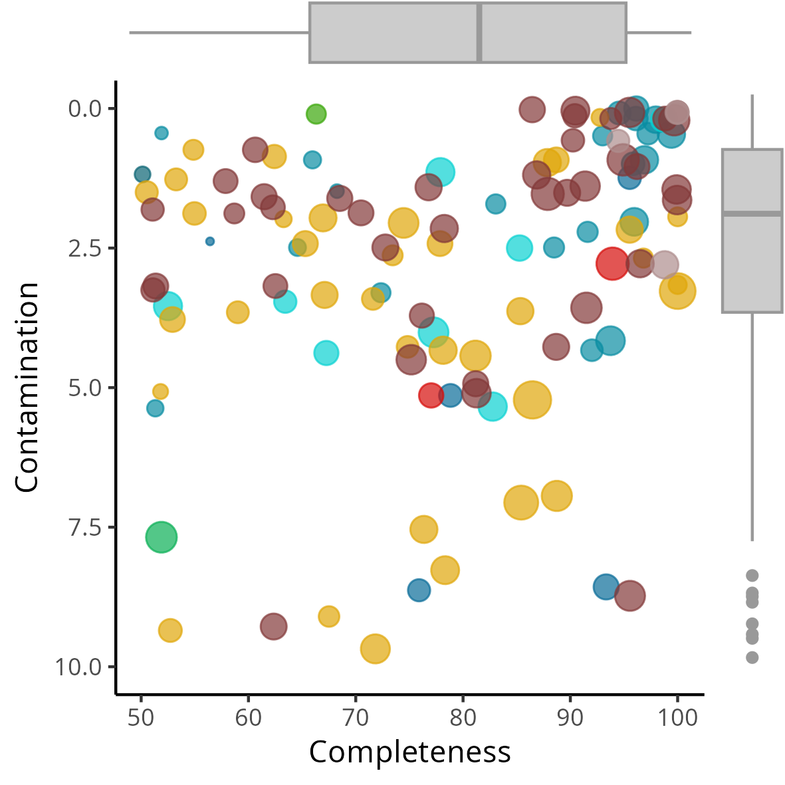
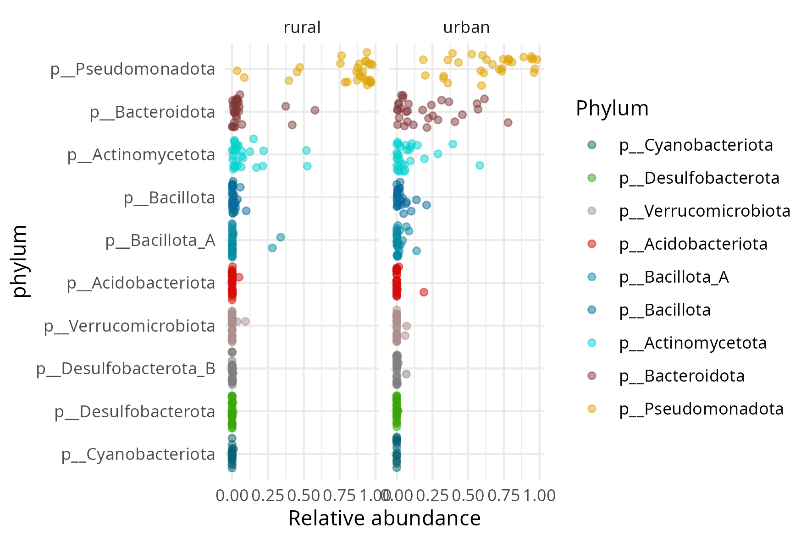
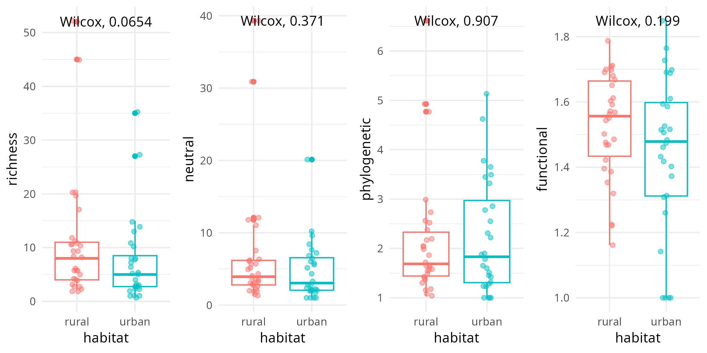
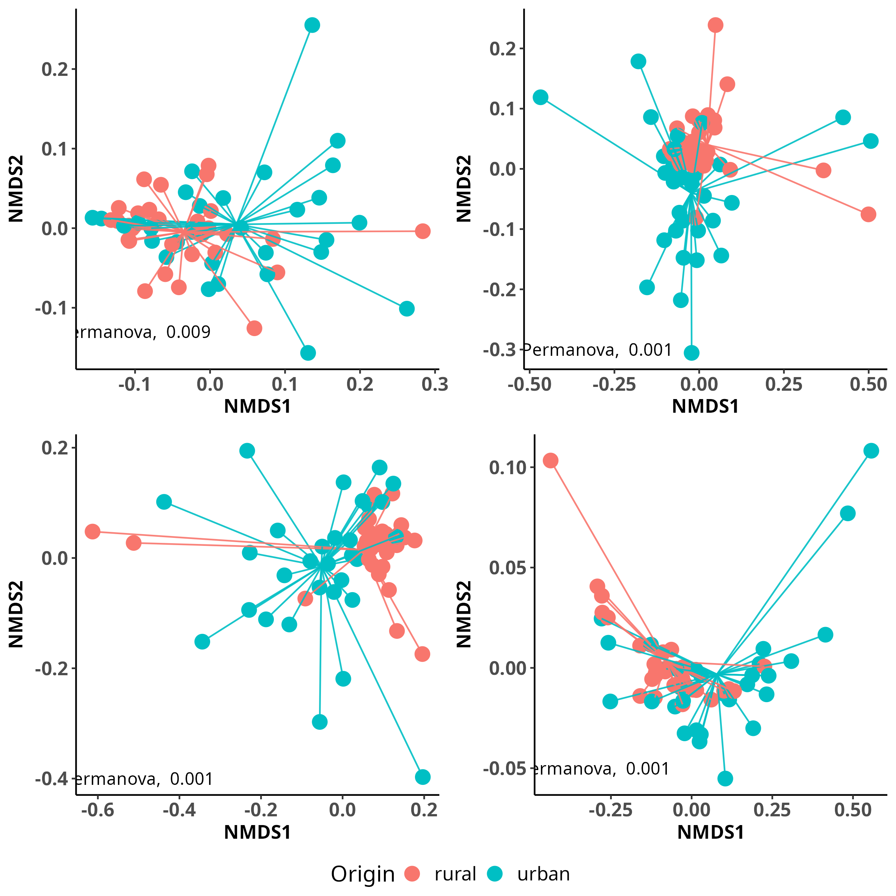

```{r knitr_opts, echo=FALSE}
knitr::opts_chunk$set(
    class.source = "script-source",
    class.output = "script-output",
    comment = NA)
```

# Abstract

# Introduction

*What are the threats toward amphibians?* Amphibians are often referred to as metaphorical "canaries in the coal mine" when it comes to global biodiversity loss, their vulnerability to multiple threats, many of which may co-occur or compound, have made amphibians conspicuous indicators of emerging threats to biodiversity [@morrell_frogs_1999; @norris_ghosts_2007; @luedtke_ongoing_2023]. The leading cause to amphibians’ declines is habitat loss and degradation, primarily through agriculture and urbanization, the latter of which dramatically changes habitat structures and increases the intensity of environmental stressors including changes in hydrology, temperature, and connectivity [@hamer_amphibian_2008; @scheffers_effects_2012; @barrett_urbanization_2014; @yang_global_2022]. Another leading cause of declines, particularly in Europe, Australia, and the Americas, has been the spread of fungal chytrid pathogens [@ohanlon_recent_2018; @rollins-smith_batrachochytrium_2021], *Batrachochytrium dendrobatidis* (Bd, @longcore_batrachochytrium_1999) and *Batrachochytrium salamandrivorans* (Bsal, @martel_batrachochytrium_2013), which have resulted in catastrophic mortality events among naive amphibian populations [@skerratt_spread_2007; @lips_overview_2016, @fisher_chytrid_2020]. Efforts to model the spread of fungal pathogens have considered environmental conditions [@crawshaw_widespread_2022; @thumsova_ecological_2025], but the effect of land-use change and urbanization on fungal risk remains largely unknown [@saenz_effects_2015; @bacigalupe_effects_2017].

*Why are we focused on microbiota?* In an effort to understand the fungus' pathology [@van_rooij_amphibian_2015], studies have examined the role that dermal microbiota have in amphibians' ability to resist fungal infections [@muletz-wolz_inhibition_2017; @le_sage_preparatory_2021; @gonzalez-serrano_amphibian_2025]. Following fungal exposure, studies have examined how microbiota communities respond to infections in an effort to understand the lasting effect and possible resistance among amphibians [@jani_amphibian_2021; @bletz_disruption_2018]. While our understanding of the role microbiota play in anti-fungal resistance is still developing, the urgency of the crisis has led some to propose interventions which may include modifying microbiota as a means to reinforce vulnerable populations [@bletz_mitigating_2013; @rebollar_amphibian_2020; @kueneman_effects_2022]. While less covered among amphibians, urban soil and water are prone to contamination from industrial and agricultural proximity [@duong_determining_2011; @cachada_levels_2012], may also impact the microbiota of urban environments and residents [@muletz_soil_2012; @hu_impervious_2018; @mclellan_microbiome_2015]. Cities should also not be discounted for their potential benefits, however, as urban green spaces may provide refuges for wildlife species [@clevenot_review_2018; @schmidt_population_2021; @gentili_urban_2024]. Among the few attempts to model chytrid fungal distributions, also suggested significantly lower rates of occurrences among urban habitats [@saenz_effects_2015]. The precise causal factor remains unknown, however, experimental studies suggest increased temperatures may impede chytrid fungal growth [@robak_effects_2023] and have observed that ephemeral ponds have lower chytrid fungal loads than permanent water bodies [@saenz_landscape-scale_2025].

*What has been done already?* To date, the majority of studies that have begun work characterizing amphibian microbiota have done so through sequencing of the 16S rRNA marker gene [@barnes_assembly_2021; @santos_skin_2023]. Amplicon enrichment metabarcoding utilizes existing microbial databases to identify the taxonomy of prokaryotes in a manner that is generally accessible and comparable between studies [@pruesse_silva_2007; @quast_silva_2013]. Comparative studies using microbial metabarcoding identified significant variations in microbiota assemblage along urbanization gradients, but not necessarily a difference in diversity therein [@jimenez_amphibian_2017; @barnes_assembly_2021; @basanta_genetic_2022; @zhou_urbanization_2023]. While suitable for repeatable taxonomic identification of prokaryote taxa, amplicon sequencing often yields a coarser taxonomic resolution and does not capture any of the functional variation which may occur within microbiome communities [@campanaro_taxonomy_2018]. While indirect methods to infer functional features of microbiomes from 16S data exist, these fully rely on genomes recorded in public databases which are largely biased towards humans and other model taxa, with barely any representation of amphibian-associated microbes, which despite having identical 16S sequences might carry significantly different functional attributes [@sun_inference-based_2020; @callahan_exact_2017].

*What is being done differently?* In this study, we instead chose to use high throughput shotgun sequencing where random short-read sequences are used to assemble microbial genomes [@weinstock_genomic_2012; @quince_shotgun_2017]. This alternative approach was considered preferable to 16S amplicon sequencing [@ranjan_analysis_2016] as it can yield improved taxonomic resolution [@ziesemer_intrinsic_2015; @durazzi_comparing_2021] and functional gene information [@bates_microbiome_2022; @eisenhofer_impact_2023]. Additionally, because this methodology uses a very minimal enrichment step, the relative abundance of taxa is better preserved [@gloor_microbiome_2017]. The compromise with this approach, however, is that host DNA is inevitably captured as well and often comprises the majority of the sequence reads [@pereira-marques_impact_2019]. Removing host DNA generally entails mappings reads to a reference, which in the case of amphibians are often unavailable and difficult to construct owing to the often large size and complexity of amphibian genomes [@sun_slow_2012; @liedtke_macroevolutionary_2018].

As our focal species, we sampled fire salamanders (*Salamandra salamandra*; Linnaeus 1758) from within and around the city of Porto, Portugal. Fire salamanders are widely dispersed and abundant amphibian species, typically associated with forest biomes, and (at least within this study region) have a biphasic life cycle that depends on temporary water bodies for larval vedelopment [@wagner_habitat_2020; @velo-anton_salamandra_2015]. Salmanders have also been reported in a variety of urban green spaces [@guilherme_porto_2015; @lourenco_trapped_2017; @iglesias-carrasco_urban_2017; @marques_coi_2022]. Fire salamanders are affected by the spread of *Bsal* [@martel_batrachochytrium_2013], with microbiome communities that may either resist or exacerbate fungal pathology [@bletz_disruption_2018; @smith_skin_2018]. To our knowledge fire salamanders have thus far only ever been subject to 16S amplicon sequencing, and while characterization of the microbiome at variable life stages and habitats are available [@sanchez_cutaneous_2017; @bletz_disruption_2018; @afonso_effects_2022], misses out on the more detailed taxonomic and functional resolution that shotgun sequencing provides [@antony-babu_multiple_2017].

*What are the aims and hypotheses?* Using a metagenomics approach, we aimed to collect information on how an amphibian's microbiome community assemblages may change in composition and function along an urbanization gradient. To do so, we visited several sites with known fire salamander populations, from within the urban core of the city and outside in the rural periphery. After sequencing dermal swabs from specimens, we then used shotgun sequencing to characterize the microbiota taxonomic composition and functional characteristics. Based on comparisons of other amphibian species, it has been reported that urbanization corresponds to increased homogeneity among urban populations, but not necessarily decreases in taxa richness or diversity [@barnes_assembly_2021; @basanta_genetic_2022; @zhou_urbanization_2023]. Therefore, we hypothesized that urbanization would correspond to differences in assemblage composition between urban and rural sites, while not necessarily correlating to differences taxa diversity. While very little functional information is known about amphibian microbiota, but based on the generalized trend toward generalist strategies among stochastic and urbanized habitats [@mckinney_urbanization_2006; @zhou_urbanization_2024; @zheng_urbanization_2025] we hypothesize that urban habitats will also have a narrower functional diversity, as generalist strategies are thought to be advantageous among stochastic and porous habitats.

# Methods

### Sampling

Porto is a large urban matrix comprised of isolated urban parks of varying size and extensive forested areas comprised of both endemic and invasive tree species [@guilherme_looking_2022]. Individuals were collected between mid October to early November of 2023, on nights of high humidity and when temperatures range from 14-22 ºC. This coincides with a season of peak activity, when males move above the leaf litter and present themselves as mating candidates and can be distinguished by the presence of an enlarged cloaca. Using sterile gloves, specimens were collected and placed in small individualized sterile containers, ideally avoiding direct contact with salamanders, instead scooping them into the containers to reduce contact with the dermis or contamination between individuals. Salamanders were then moved to laboratory facilities the following morning to proceed with swabbing.

During swabbing a technician wearing sterile gloves (replace between samples) restrained individual salamanders by the base of the tail, using sterile paper towel to help maintain a grip. Individual were then sprayed thoroughly with distilled H2O to remove debris from the dermis. Once rinsed, the individual dermis will be swabbed ten times on the dorsal, ventral, and each side with a swab then placed in a 2 mL tube pre-filled with PBS buffer and frozen at -20ºC. After swabbing individuals are returned to their individual containers then returned to the sampled location later the same day.

```{r,  warning=FALSE, comments="", message=FALSE, eval=FALSE, echo=FALSE}
library(dplyr)
library(tinytable)
type_of_test <- c('T-test','F-test','Regression')
small <- c(.2, .1, .02)
medium <- c(.5, .25, .15)
large <- c(.8, .4, .35)
data.frame(type_of_test,small,medium,large)  %>% 
  tt()
# expected effect size
k = 2
f = NULL
n = 30
sig.level = 0.05
power = 0.85
# t test comparison between two groups
pwr::pwr.t.test(n = 30,
                sig.level = sig.level,
                power = power)
```

### Sequencing

Samples were processed in October 2024 at the Globe Institute’s (University of Copenhagen) molecular laboratory in Copenhagen, Denmark, following the established EHI laboratory protocols available at www.earthhologenome.org/laboratory [@pietroni_hologenomic_2025]. Samples underwent bead-beating to before DNA isolation employing silica magnetic beads with solid-phase reversible immobilisation. The concentration of DNA extracts was quantified using a Qubit™ 3 Fluorometer (Thermo Fisher Scientific, USA). Subsequently, DNA was fragmented into approximately 450 bp-long fragments using a Covaris LE220 platform. Library preparation followed the ligation-based BEST protocol [@caroe_single-tube_2018], utilising a standard input of 200 ng of DNA in 24 µl or the closest amount feasible based on the sample DNA concentration. We used 1.5 µl of 20 µM adaptors for a 50-200 ng DNA input, 1.5 µl of 10 µM for 10-50 ng, 1.5 µl of 5 µM for \<10 ng, and 1.5 µl of 2 µM for samples below the quantification range of the Qubit® dsDNA HS (High Sensitivity) Assay Kits. Libraries underwent qPCR screening to determine the optimal number of library indexing PCR cycles [@murray_benchtop_2015], followed by PCR amplification using unique dual index primers with an adjusted number of cycles. The resulting libraries underwent automated capillary electrophoresis (Bioanalyzer or Fragment Analyzer) for assessment of fragment-length distribution, adaptor dimers, and adaptor-to-library molar ratios. Finally, samples were pooled into multiple sequencing batches, and sequencing was performed across multiple lanes of NovaSeq6000 and NovaSeq X platforms (Illumina, USA), generating \_\_\_ GB (approximately \_\_\_\_ million reads) of 150 bp paired-end sequencing data per sample.

### Bioinformatics

Raw metagenomic reads were processed following the bioinformatic workflow by the Earth Hologenome Initiative (see @leonard_global_2024; <https://www.earthhologenome.org/>), and stored in the Electronic Research Data Archive (ERDA) of the University of Copenhagen. Computation was conducted in the local cluster of the Globe Institute (Mjolnir) using the snakemake- and slurm-based bioinformatic pipelines tailored to the platform (<https://github.com/earthhologenome/EHI_bioinformatics/tree/mjolnir>). Quality filtering to remove adapters, low-quality reads (phred \>= 20), short reads (\>= 60 bp), and polyG/polyX tails was done with Fastp v.0.23.4 [@chen_fastp_2018]. With skin swabs, the majority of DNA extracted is expected to belong to the host, and so the proportion of prokaryotic sequences were estimated using SingleM microbial fraction [@eisenhofer_quantifying_2024]. Host-derived reads were removed by mapping against a reference host genome using Bowtie2 v.2.5.1 [@langmead_fast_2012] and Samtools v.1.18 [@danecek_twelve_2021]. In the absence of a reference genome for *S. salamandra*, we used a *Salamandra salamandra* transcriptome (NCBI RefSeq HBZU010000000; @libro_novo_2023) in addition to the reference genome of *Pleurodeles waltl* (NCBI RefSeq assembly GCF_031143425.1; @brown_chromosome-scale_2025) which is the next most phylogenetically related species with a reference genome available [@zhang_phylogeny_2008]. Unmapped metagenomic reads were assembled into contigs then into putative bacterial genomes known as *metagenome-assembled genomes (MAGs)* by MEGAHIT v.1.2.9 [@li_2016]. The quality of these MAGs for subsequent downstream analyses was evaluated with Quast [@gurevich_quast_2013] and contig coverage was determined by CoverM [@aroney_coverm_2025]. Metagenomic binning was performed by multiple algorithms, including CONCOCT v.1.1 [@alneberg_binning_2014], MetaBAT2 v.1.7 [@kang_metabat_2019], and MaxBin2 v.2.2.4 [@wu_maxbin_2016], the refined by MetaWRAP [@uritskiy_metawrapflexible_2018] into consensus bins. Taxonomical annotations of MAGs were matched to the Genome Taxonomy Database (GTDB) with the taxonomic classification toolkit (GTDB-Tk) [@chaumeil_gtdb-tk_2022; @parks_gtdb_2022]. Genome-Inferred Functional Traits (GIFTs) of MAGs were assigned with DRAM [@shaffer_dram_2020] using the Pfam [@finn_pfam_2016], KEGG [@kanehisa_kegg_2017], UniProt [@mcgarvey_uniprot_2019], CAZY [@cantarel_carbohydrate-active_2009], and MEROPS [@rawlings_merops_1999] databases and distillR (available at <https://github.com/anttonalberdi/distillR>). An average nucleotide identity (ANI) of 98% and a minimum genome completeness of 50% were used to dereplicate highly similar MAGs using dRep [@olm_drep_2017]. Reads were then mapped to a MAG catalogue to extract quantitative read-abundance information to calculate relative abundance of each MAG per sample, retaining only those with completeness values above 50% and contamination levels below 10% [@bowers_minimum_2017].

### Statistics

For each sample, we calculated the proportion of sequenced bases that were filtered due to poor quality, unmapped, mapped to the host, and mapped to a MAG. The domain-adjusted mapping rate (DAMR) was used to quantify microbial genome recovery from metagenomes, calculated as the rate of read mapping to sets of microbial genomes (MAGs or other references) divided by the fraction of the community predicted to be prokaryote [@eisenhofer_quantifying_2024. Differences in the proportion of mapped bases between habitats was determined through a Wilcox rank test [@bauer_constructing_1972]. Additionally, MAG compistion was measured as the relative abundance of each MAG was determined as the number of assigned reads as a proportion of the MAG length divided by average read length to [@gloor_compositional_2016; @gloor_microbiome_2017], with a Tukey's Honest Significant Difference test (TukeyHSD, @tukey_problem_1953) to identify significant differences in relative abundance between habitats at the phylum, class, and family taxonomic scale.

Dissimilarities between site and habitat MAGs composition were calculated in terms of richness as well as neutral, phylogenetic and functional beta diversities using Hill numbers [@hill_diversity_1973; @chao_unifying_2014]. While considering community richness (q = 0), evenness (q \> 0), and disparity between groups. Neutral Hill numbers represent species diversity without considering the degree of relatedness among MAGs; phylogenetic Hill numbers incorporate branch-length information of the phylogenetic tree of the MAGs; functional Hill numbers consider functional differences among MAGs [@hernandez_contrasting_2024] calculated using Hilldiv2 v.2.0.2 [@alberdi_hilldiv_2019]. The betadisper function in vegan v.2.6-10 [@oksanen_package_2013] was applied to test differences in dispersion within sampling methods. PERMANOVA was performed to test for differences in microbial composition between sampling methods using the adonis2 function in vegan, with individual identity as a blocking factor to control for repeated sampling using the strata function. Once again, Wilcoxon rank sum test was used to test for differences in the variance within each group when comparing habitats and an analysis of variance (ANOVA; @chambers_statistical_1992) was used to compare differences in variance between sites. To visualize bacteria according to their functional features, the MAGs were ordinated based on their GIFTs through a t-SNE analysis using the Rtsne package v.0.17 [@krijthe_rtsne_2015]

All statistical analyses were performed using the R software v.4.5.0 (R Core Team, 2025).

#### Additional methods

When comparing distinct taxa between habitats, address how we will handle the occurrence of zeroes, either as unobserved enrichements (structural zero) or true absences. This may vary by group, where true absences can be concluded at coarse but not higher resolutions.

A new annotation pipeline with focus on toxicology will replace the older one that was intended for more intestinal microbiota functions.

ANCOMBC is a method that will test for statistical differences between groups accounting for the differences in taxonomic resolution and structure.

A possible consideration, is the removal of the functional component. Concerns we have are the designations between groups, and whether it would not be better to compare functional differences along a continuous multivariate scale, (imperviousness, eucalyptus, emisssions, etc.) possibly using HMSC. Additionally, we need to establish a threshold of effect (e.g. \>0.05) since statistical significant can be identified between two groups if the effect only differs by 0.01 but the overall effect is close to zero.

# Results

Sequencing libraries included a total of 60 swabs used to generate approximately 105M total reads (mean ± SD = 1.75 ± 2.69, median = 1.11, M reads per sample) of short-read DNA sequencing data. Quality filtering and host read removal resulted in 98.5M filtered reads (mean ± SD = 1.69 ± 2.68 , median = 0.991, Gb per sample) metagenomic data, which were assembled into 119 metagenome-assembled genomes (MAGs) that passed our minimum quality criteria (CheckM2 estimated completeness \>50%, contamination \<10%). With a mean 4.42 ± 1.89 Gb per sample, on average 5.8% were mapped to MAGs, while 5.3% were removed for low quality, 0.3% mapped to the host, and a substantial 88.6% were unmapped. The domain adjusted mapping rate was that an estimated 22.5 ± 20.8 % of reads were successfully mapped to MAGs.

No significant differences were observed in the filter reads counts between sites or habitats.

| site       | habitat | n   |
|------------|---------|-----|
| Matosinhos | U       | 11  |
| Tait       | U       | 11  |
| Carrizal   | U       | 8   |
| Mindelo    | R       | 11  |
| Vairao     | R       | 8   |
| Avioso     | R       | 11  |

The mean proportion of estimated prokaryote reads per sample was 32.92 ± 21.8, however, the mean proportion of reads assigned to MAGs was only 6.37 ± 7.8. Wilcox Test significant lower proportion of bases assigned to MAGs among urban samples as compared to rural samples (W = 709, p = 0.0001).


## Taxonomy and Function

##### *Which are the most abundant taxa?*

Majority of MAGs identified were ascribed to phyla Bacteroidota (33.61%), Pseudomonadota (30.25%), and Bacillota_A (17.65%)

| phylum             | n\. MAGs | \% MAGs |
|--------------------|----------|---------|
| Bacteroidota       | 40       | 33.61   |
| Pseudomonadota     | 36       | 30.25   |
| Bacillota_A        | 21       | 17.65   |
| Actinomycetota     | 8        | 6.72    |
| Bacillota          | 5        | 4.20    |
| Verrucomicrobiota  | 4        | 3.36    |
| Acidobacteriota    | 2        | 1.68    |
| Cyanobacteriota    | 1        | 0.84    |
| Desulfobacterota   | 1        | 0.84    |
| Desulfobacterota_B | 1        | 0.84    |

##### *What is the average size / completeness / contamination / quality of MAGs?*

Average corrected size 3.969x10^6^ bp.

Minimum MAG size corresponds to *Mycoplasma sp.* at 1.351x10^6^ bp.

Maximum MAG size corresponds to a taxa from the order Binatales at 9.444x10^6^ bp.

Average MAG completeness (79.3 ± 16.06) and contamination (2.75 ± 2.42)



##### *Are any phylum / families are more common / unique to a specific habitat?*

TukeyHSD test identified significant differences in relative abundance between habitats among phyla Bacteroidota and Pseudomonadota, more sepcifically at the class resolution between Bacteroidia and Gammaproteobacteria, and at the family scale Moraxellaceae.

(p)Bacteroidota (f)Chitinophagaceae is observed exclusively among samples from urban habitats, specifically a few individuals from Carrizal.

(p)Actinomycetota (f)Pseudonocardiaceae and (p)Bacillota (f)Erysipelotrichaceae are two Families with several identified taxa observed exclusively among samples from rural habitats. The former is specific to Vairão and the latter is among the most sparsely represented families.



##### *How does alpha diversity compare between habitats?*

No significant differences between habitats in regards to alpha diversity.



##### *How does richness / neutral / phylogenetic / functional beta diversity compare between habitats?*



##### *How does richness / neutral / phylogenetic / functional beta diversity compare between sites within habitats?*


| Code_function | Domain       | Function                           |
|---------------|--------------|------------------------------------|
| B01           | Biosynthesis | Nucleic acid biosynthesis          |
| B02           | Biosynthesis | Amino acid biosynthesis            |
| B03           | Biosynthesis | Amino acid derivative biosynthesis |
| B04           | Biosynthesis | SCFA biosynthesis                  |
| B06           | Biosynthesis | Organic anion biosynthesis         |
| B07           | Biosynthesis | Vitamin biosynthesis               |
| B08           | Biosynthesis | Aromatic compound biosynthesis     |
| B09           | Biosynthesis | Metallophore biosynthesis          |
| **B10**       | Biosynthesis | Antibiotic biosynthesis            |
| **D01**       | Degradation  | Lipid degradation                  |
| D02           | Degradation  | Polysaccharide degradation         |
| D03           | Degradation  | Sugar degradation                  |
| D04           | Degradation  | Protein degradation                |
| D05           | Degradation  | Amino acid degradation             |
| D06           | Degradation  | Nitrogen compound degradation      |
| D07           | Degradation  | Alcohol degradation                |
| **D08**       | Degradation  | Xenobiotic degradation             |
| D09           | Degradation  | Antibiotic degradation             |
| S01           | Structure    | Cellular structure                 |
| S02           | Structure    | Appendages                         |
| **S03**       | Structure    | Spore                              |

# Discussion

Initial attempts to construct MAGs led to improbably large genome assemblies. To see if this resulted from incorrectly assembled host genomes, mapping to a *Salamandra salamandra* transcriptome [GenBank: HBZU000000000.1] was performed [@libro_2023.

Specific list of bacteria associated with Bsal resistance [@Muletz-Wolz_inhibition_2017]

Concluded urbanization increased the richness and homogenization of microbes in amphibian hosts, that the microbial taxa of amphibian hosts presented high heterogeneity in wild areas and high homogeneity in urban areas. This may suggest that there is remarkable habitat variation between sample sites in the wild, which leads to significant differentiation of symbiotic microorganisms. In contrast, urban habitats tend to have more similar habitats, which results in similar environmental pressures and symbiotic microbial convergence. Passive dispersal could play crucial roles in community assembly (Ai et al., 2013; Jia et al., 2018), as the diverse and distinctive urban local species spool may bring more low-abundance rare or unique taxa to the amphibians, thus causing high turnover and increasing the stochasticity (Stegen et al., 2015). Node network suggests that although urbanization reduces the complexity of the network, it increases the functional units to cope with various risks or pressures brought by the urban environment. @zhou_urbanization_2023

Comparisons between habitats suggest relative microbial abundance of Proteobacteria, Firmicutes, and Actinobacteria is higher in rural areas. @zhou_urbanization_2023 Difference at the family level, differences in microbial community composition differences. @zhou_urbanization_2023 overall microbial diversity was consistently higher in urban groups at the species-level richness, Shannon index, and phylogenetic diversity @zhou_urbanization_2023 Beta diversity was significantly higher between the woodland group than in the urban group @zhou_urbanization_2023 For bacteria, found no significant difference in Shannon diversity by level of urbanization @barnes_assembly_2021 The main differences in bacterial taxonomic composition along the land-use gradient was the relative abundances of Actinobacteria, Bacteroidetes and Verrucomicrobia. @barnes_assembly_2021

Prior 16S studies suggest the most common prokaryote phylum on amphibians' epidermis are usually Proteobacteria, Bacteriodetes, and Actinobacteria [@mckenzie_2012; @jimenez_2019; @barnes_2021; @walke_2021; @martinez-ugalde_2024; @wan_2024].

(g)Acinetobacter associated with antifungal properties in other amphibians [@cevallos_genomic_2022]. (f)Enterobacteriaceae associated with pathogenesis among other amphibians [@diaz_identification_2025].

Organic pollutants, such as polycyclic aromatic hydrocarbons (PAHs) which typically originate from motor vehicle exhaust and industrial activities, have also been reported at higher concentrations among historical urban parks located in larger industrialized cities with a longer history of industrial pollution [@cachada_2012].

# Acknowledgements

Thanks to Carlos Caballero-Díaz for assistance with sampling, to Isolde van Riemsdijk for consulting on sampling best practices.

This publication was funded through the generous support of the Fundação para a Ciência e a Tecnologia (FCT) as part of the project "ANTHROPHIBIANS: adaptive genomic and microbiotic responses of amphibians in anthropogenic landscapes" (2021.05570.BD; <https://doi.org/10.54499/2021.05570.BD>).

### Data accessibility

The raw data tables containing the quantitative information and bioinformatic code scripts used for the analysis are available in a dedicated GitHub repository, both rendered into a html webbook (XXXXXXXX) and frozen in Zenodo with Doi: XXXXXXXXX. Raw sequencing data and microbial genome sequences, have been or will be published as part of the 2nd EHI Data Release, under the Bioproject PRJEB77033.

# Supplementary Materials

# Bibliography
