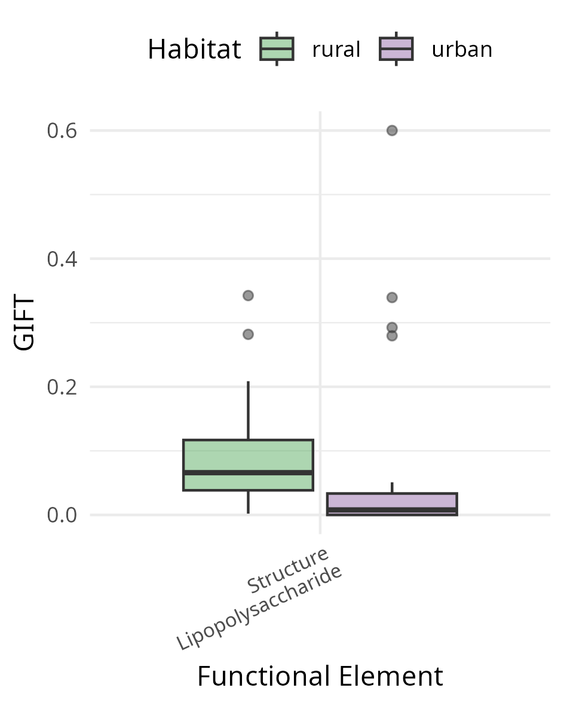
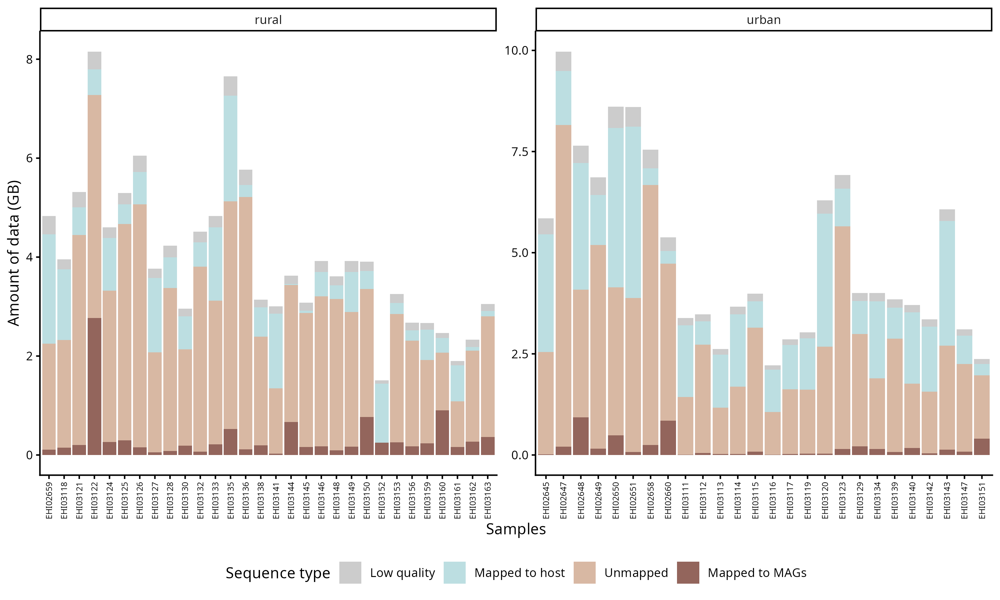
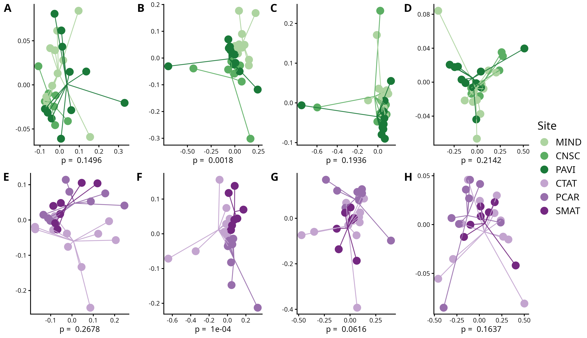

```{r knitr_opts, echo=FALSE}
knitr::opts_chunk$set(
    class.source = "script-source",
    class.output = "script-output",
    comment = NA,
    echo = FALSE)
```

^1^ Departamento de Biologia, Faculdade de Ciências, Universidade do Porto, 4099-002 Porto, Portugal

^2^ CIBIO, Centro de Investigação em Biodiversidade e Recursos Genéticos, InBIO Laboratório Associado, Campus de Vairão, Universidade do Porto, 4485-661 Vairão, Portugal

^3^ BIOPOLIS Program in Genomics, Biodiversity and Land Planning, CIBIO, Campus de Vairão, 4485-661 Vairão, Portugal

^4^ Center for Evolutionary Hologenomics / GLOBE Institute, University of Copenhagen, 1353 Copenhagen K, Denmark

⁵ Universidad de Vigo, ECOEVO Lab, EE Forestal, Campus Universitario A Xunqueira, E-36005, Pontevedra, Spain

AJDM (ORCID: 0000-0002-6070-0506); NG (ORCID: 0009-0002-3068-4653); GVA (ORCID: 0000-0002-9483-5695); AA (ORCID: 0000-0002-2875-6446)

\newpage

# Abstract

The amphibian dermis is essential for individuals' health, affecting respiration, hydration, and defence. Maintenance and regulation of dermal health are at least partly regulated by resident microbiota, which is influenced by environmental pressures. Urbanization is one of the factors known to affect anima-associated microbiomes; however, its effects on amphibian skin microbiota remain poorly understood. Here we studied whether and how the dermal microbiome of the fire salamander (*Salamandra salamandra* Linnaeus, 1758) varies in taxonomic composition and functionality between urban and rural habitats. We used genome-resolved metagenomics to assemble microbial genomes, estimate functional capabilities of dermal communities, and analyze variation across environments. Our results showed comparable levels of microbiome diversity across habitats. Community composition and functional capabilities, however, differed between environments, with several microbial taxa and metabolic functions enriched in rural salamanders  relative to urban ones. This work provides a high-resolution account of microbiome variance across a land-use gradient in a vulnerable amphibian species and warrants further investigation into the environmental drivers shaping host-associated microbiomes and their implications for amphibian health.

# Introduction

Amphibians thin permeable skin is considered one of the earliest adaptations among vertebrates to terrestrial life, allowing for transdermal gas and water exchange [@akat_comden_complex_2023; @tattersall_skin_2007]. Increased permeability, however, comes at the expense of increased water loss vulnerability to xenobiotics, and pollutants [@purucker_estimating_2023; @toledo_cutaneous_1993; @kaufmann_adaption_2016; @quaranta_why_2009]. Amphibians' sensitivity to environmental stress has led to their generalization as indicators of biodiversity loss, and are the most threatened vertebrate group [@cox_global_2022; @luedtke_ongoing_2023; @morell_frogs_1999; @norris_ghosts_2007]. Given the importance of the dermis to amphibian health, attention has been directed toward understanding the role dermal microbiota have in maintaining dermis health and function [@hernandez-gomez_organismal_2023; @zhu_skin_2024]. Dermal microbiota contribute to chemical signaling, maintenance of the mucosal layer, and production of bacterial metabolites contributing to the hosts' defence against pathogens [@kueneman_amphibian_2014; @muletz-wolz_inhibition_2017; @le_sage_preparatory_2021; @gonzalez-serrano_amphibian_2025; @woodhams_adaptive_2023; @demori_peptides_2019; @pereira_skin_2018].

Following catastrophic amphibian mortality events attributed to chytrid fungal pathogens, *Batrachochytrium dendrobatidis* (*Bd*; @longcore_batrachochytrium_1999) and *Batrachochytrium salamandrivorans* (*Bsal*; @martel_batrachochytrium_2013) [@fisher_chytrid_2020; @ohanlon_recent_2018; @rollins-smith_batrachochytrium_2021; @castro_monzon_batrachochytrium_2022], contemporary research on amphibian microbiota has focused on the role of microbiota in antifungal defence [@ross_skin_2019]. While investigations have explored the impact of fungal infections on disrupting dermal microbiota assemblages, less is known about how environmental conditions structure the dermal microbiome prior to infection. Studies have suggested that alterations to microbial communities increased susceptibility to pathogens and contributed to the formation of lesions [@becker_cutaneous_2010; @bletz_disruption_2018; @zhu_skin_2024; @luddecke_salamanders_2018]. Understanding the ecological conditions that influence microbiome composition is therefore a key step in anticipating the vulnerability of amphibian populations.

Habitat loss and degradation through agriculture and urbanization are the primary contributor to amphibian declines [@luedtke_ongoing_2023]. Urbanization, in particular, dramatically alters habitats and increases the intensity of environmental stressors associated with hydrology, temperature, and connectivity [@hamer_amphibian_2008; @scheffers_effects_2012; @barrett_urbanization_2014; @yang_global_2022; @lourenco_trapped_2017]. Urban amphibian residents often display reductions in body condition and fitness [@iglesias-carrasco_urban_2017; @jennette_variation_2019], phenotypic differentiation [@alarcon-rios_urban_2024; @alarcon-rios_methodological_2024], or alterations in dietary composition [@marques_urbanization_2026] when compared to those from rural or native habitats. Furthermore, urban soil and water are prone industrial and agricultural pollution [@cachada_levels_2012; @coban_soil_2022; @liu_microbial_2025; @mclellan_microbiome_2015; @soto-pozos_imprints_2025; @jimenez_fungicide_2021] altering the microbiota reservoir for dermal microbiota colonization in the environment [@walke_amphibian_2014; @barnes_assembly_2021; @loudon_microbial_2013; @loudon_microbial_2013].

Many studies characterizing amphibian microbiota have used metabarcoding of the 16S rRNA marker gene [@barnes_assembly_2021; @santos_skin_2023; @muletz_wolz_effects_2018; @afonso_effects_2022]. While suited for taxonomic identification of prokaryote taxa, amplicon sequencing can result in a coarse taxonomic resolution that omits functional variation within microbiome communities [@campanaro_taxonomy_2018; @durazzi_comparison_2021]. Furthermore, metabarcoding relies on sequence databases with limited representation of amphibian-associated microbes[@sun_inference-based_2020; @callahan_exact_2017]. Genome-resolved metagenomics instead generates random short-read DNA sequences to assemble microbial genomes upon which community-level microbiome inferences are built [@weinstock_genomic_2012; @quince_shotgun_2017; @aizpurua_beyond_2026]. This approach provides larger sequence assemblies improving taxonomic resolution while capturing functional gene information [@bates_microbiome_2022; @eisenhofer_impact_2023; @ziesemer_intrinsic_2015; @durazzi_comparison_2021].

The fire salamanders (*Salamandra salamandra*; Linnaeus 1758) is widely distributed across Europe. While primarily associated with forest ecosystems [@wagner_habitat_2020; @velo-anton_salamandra_2015; @dinis_dry-climate_2025] they are also tolerant to urban habitats [@lourenco_trapped_2017; @iglesias-carrasco_urban_2017; @marques_coi_2022; @alarcon-rios_urban_2024; @marques_urbanization_2026]. Our aim was to characterize the dermal microbiome of the fire salamander and analyze how its taxonomic composition and functional potential vary between urban and rural habitats. To this end, we employed genome-resolved metagenomics to reconstruct microbial genomes and compare the composition and metabolic capabilities of bacterial communities associated with salamanders inhabiting environments that differed in the degree of urbanization. Previous studies of urban amphibian microbiota report that urbanization can alter amphibian-associated microbiomes, often resulting in greater similarity among urban populations but not necessarily decreases in taxonomic richness or diversity [@barnes_assembly_2021; @basanta_genetic_2022; @zhou_urbanization_2023; @touceda-suarez_differences_2025; @wheeler_effects_2025]. Such patterns may arise because recurrent anthropogenic disturbances may disrupt microbial community structure, providing opportunities for colonization by disturbance-tolerant taxa [@hu_impervious_2018]. We hypothesized that dermal microbiota would differ between urban and rural habitats, with urban populations exhibiting lower among-site variability and a greater prevalence of generalist taxa adapted to environmental perturbation [@zheng_urbanization_2025; @clavel_worldwide_2011]. Furthermore, we hypothesized that these same disturbances would result in less complete functional pathways among microbial assemblages among urban residents.

# Methods

### Sampling

Sampling was conducted in urban parks and around the city of Porto in Portugal, Europe (Figure 1). The urban matrix is comprised of isolated urban parks of varying size with extensive forested areas comprised of either endemic (e.g. *Quercus, Acer*) and invasive tree species (e.g. *Eucalyptus, Acacia*) intersected by small agricultural plots [@guilherme_looking_2022]. Sites were generalized as either urban or rural based on their proximity to the urban metropolitan core of the city [@madureira_green_2011]. Additionally, we measured the proportion of impervious surface within a 200m of the sampled site, and found a significant difference between mean impervious surface between either habitat using a two sample t-test (urban = 50.4%, rural 2.3%, t = 4.9, p < 0.05). Up to 11 samples were collected when possible. Urban sites were small semi-forested plots (\~9 ha) surrounded by impervious surfaces such as roads and built structures. Rural sites, by contrast, were large areas (27-39 ha) with extensive tree cover, usually endemic deciduous species, and surrounded by agricultural or agroforestry plots. Individuals were collected between mid-October to early November 2023, on nights of high humidity and when temperatures range from 14-22 ºC. This coincides with a season of peak activity when males, distinguished by the presence of an enlarged cloaca, move above the leaf litter and present themselves as mating candidates [@velo-anton_salamandra_2015]. Using sterile gloves, specimens were collected and placed in small individualized sterile containers, avoiding direct contact by scooping them into the containers. Salamanders were then moved to laboratory facilities at Research Centre in Biodiversity and Genetic Resources (CIBIO) in Vairão, Portugal, the following day. During swabbing, a technician wearing sterile gloves (replaced between samples) restrained individual salamanders by the base of the tail using sterile paper towel to help maintain a grip. Individual were sprayed thoroughly with distilled H~2~O to remove debris then swabbed with ten stokes on the dorsal, ventral, and each lateral side. Swabs were placed in a 2 mL tube pre-filled with DNA/RNA Shield (Zymo Research) and frozen at -20ºC. Afterward, individuals were returned to the sampled location later the same day.

```{r,  warning=FALSE, comments="", message=FALSE, eval=FALSE, echo=FALSE}
library(dplyr)
library(tinytable)
type_of_test <- c('T-test','F-test','Regression')
small <- c(.2, .1, .02)
medium <- c(.5, .25, .15)
large <- c(.8, .4, .35)
data.frame(type_of_test,small,medium,large)  %>% 
  tt()
# expected effect size
k = 2
f = NULL
n = 30
sig.level = 0.05
power = 0.85
# t test comparison between two groups
pwr::pwr.t.test(n = 30,
                sig.level = sig.level,
                power = power)
```

### Sequencing

Samples were processed in October 2024 at the Globe Institute’s (University of Copenhagen) molecular laboratory in Copenhagen, Denmark, following the established EHI laboratory protocols available at www.earthhologenome.org/laboratory [@pietroni_hologenomic_2025]. Samples underwent bead-beating before DNA isolation employing silica magnetic beads with solid-phase reversible immobilization [@lauritsen_robust_2025]. The concentration of DNA extracts was quantified using a Qubit™ 3 Fluorometer (Thermo Fisher Scientific, USA). DNA was fragmented into approximately 450 bp-long fragments using a Covaris LE220 platform. Library preparation followed the ligation-based BEST protocol [@caroe_single-tube_2018], utilizing a standard input of 200 ng of DNA in 24 µl or the closest amount feasible based on the sample DNA concentration. We used 1.5 µl of 20 µM adapters for a 50-200 ng DNA input, 1.5 µl of 10 µM for 10-50 ng, 1.5 µl of 5 µM for \<10 ng, and 1.5 µl of 2 µM for samples below the quantification range of the Qubit® dsDNA HS (High Sensitivity) Assay Kits. Libraries underwent qPCR screening to determine the optimal number of library indexing PCR cycles [@murray_benchtop_2015], followed by PCR amplification using unique dual index primers with an adjusted number of cycles ranging from X~1~-X~2~. The resulting libraries underwent automated capillary electrophoresis (Bioanalyzer or Fragment Analyzer) for assessment of fragment-length distribution, adapter dimers, and adapter-to-library molar ratios. Finally, samples were pooled into multiple sequencing batches, and sequencing was performed across multiple lanes of NovaSeq6000 and NovaSeq X platforms (Illumina, USA), generating 9 GB (approximately 30 million reads) of 150 bp paired-end sequencing data per sample.

### Bioinformatics

Raw metagenomic reads were processed following the bioinformatic workflow outlined by the Earth Hologenome Initiative (see @leonard_global_2024; <https://www.earthhologenome.org/>), and stored in the Electronic Research Data Archive (ERDA) of the University of Copenhagen. Computation was conducted in the local cluster of the Globe Institute (Mjolnir) using the snakemake- and slurm-based bioinformatic pipelines tailored to the platform (<https://github.com/earthhologenome/EHI_bioinformatics/tree/mjolnir>). Quality filtering to remove adapters, low-quality reads (phred \>= 20), short reads (\>= 60 bp), and polyG/polyX tails was done with Fastp v.0.23.4 [@chen_fastp_2018]. With skin swabs, the majority of DNA extracted is expected to belong to the host, and so the proportion of prokaryotic sequences were estimated using SingleM microbial fraction [@eisenhofer_quantifying_2024]. Host-derived reads were removed by mapping against a reference host genome using Bowtie2 v.2.5.1 [@langmead_fast_2012] and Samtools v.1.18 [@danecek_twelve_2021]. In the absence of a reference genome for *S. salamandra*, we used a *Salamandra salamandra* transcriptome (NCBI RefSeq HBZU010000000; @libro_novo_2023) in addition to the reference genome of *Pleurodeles waltl* (Michahelles, 1830) (NCBI RefSeq assembly GCF_031143425.1; @brown_chromosome-scale_2025), which was the most phylogenetically related species with a reference genome available at the time [@zhang_phylogeny_2008]. Unmapped metagenomic reads were assembled into contigs then into putative bacterial genomes known as *metagenome-assembled genomes (MAGs)* by MEGAHIT v.1.2.9 [@li_megahit_2016]. The quality of these MAGs for subsequent downstream analyses was evaluated with Quast [@gurevich_quast_2013] and contig coverage was determined by CoverM [@aroney_coverm_2025]. Metagenomic binning was performed by multiple algorithms, including CONCOCT v.1.1 [@alneberg_binning_2014], MetaBAT2 v.1.7 [@kang_metabat_2019], and MaxBin2 v.2.2.4 [@wu_maxbin_2016], the refined by MetaWRAP [@uritskiy_metawrapflexible_2018] into consensus bins. Bins that passed the CheckM2 [@chklovski_checkm2_2023] quality criteria of \>50% completeness and \<10% contamination were considered as metagenome-assembled genomes (MAGs) for downstream analyses [@bowers_minimum_2017].

Taxonomical annotations of MAGs were matched to the Genome Taxonomy Database (GTDB) with the taxonomic classification toolkit (GTDB-Tk) [@chaumeil_gtdb-tk_2022; @parks_gtdb_2022]. Genome-Inferred Functional Traits (GIFTs) of MAGs were assigned with DRAM [@shaffer_dram_2020] using the Pfam [@finn_pfam_2016], KEGG [@kanehisa_kegg_2017], UniProt [@mcgarvey_uniprot_2019], CAZY [@cantarel_carbohydrate-active_2009], and MEROPS [@rawlings_merops_1999] databases and distillR (available at <https://github.com/anttonalberdi/distillR>). An average nucleotide identity (ANI) of 98% and a minimum genome completeness of 50% were used to dereplicate highly similar MAGs using dRep [@olm_drep_2017]. Reads were then mapped to a MAG catalogue to extract quantitative read-abundance information to calculate relative abundance of each MAG per sample.

### Statistics

For each sample, we determined the proportion of sequenced bases that were mapped to MAGs as compared to those that were filtered due to poor quality, unmapped, or mapped to the host. The domain-adjusted mapping rate (DAMR) was used to quantify microbial genome recovery from metagenomes, calculated as the rate of read mapping to sets of microbial genomes (MAGs or other references) divided by the fraction of the community predicted to be prokaryote [@eisenhofer_quantifying_2024]. Differences in the proportion of mapped bases between habitats were determined through a Wilcox rank test [@bauer_constructing_1972]. The relative abundance of each MAG was defined as the number of assigned reads as a proportion of the MAGs' length, divided by average read length [@gloor_compositional_2016; @gloor_microbiome_2017], with a centred log ratio (CLR) transformation used to remove the constant-sum constraint and to centre values around zero [@aitchison_statistical_1982]. Differences between habitats in the relative abundances of taxa were determined with an Analysis of Compositions of Microbiomes with Bias Correction 2 (ANCOMB2) [@lin_analysis_2020] and reported as log-fold changes between habitats; this analysis was repeated at each taxonomic resolution.

Differences in MAG richness as well as neutral, phylogenetic, and functional beta diversities were calculated with Hill numbers [@hill_diversity_1973; @chao_unifying_2014] using Hilldiv2 v.2.0.2 [@alberdi_hilldiv2_2025]. Neutral diversity represent species diversity without considering the degree of relatedness among MAGs, phylogenetic diversity incorporate branch-length information of the phylogenetic tree of the MAGs, and functional diversity consider functional differences among MAGs [@hernandez_contrasting_2024]. Differences in richness and diversity estimates between habitats and or/sites were determined with the *betadisper* function in vegan v.2.6-10 [@oksanen_package_2013]. A permutational multivariate analysis of variance (PERMANOVA) was performed to test for differences in microbial composition between habitats using the *adonis2* function in vegan. Once again, Wilcoxon rank sum test was used to test for differences in the variance within each group when comparing habitats and an analysis of variance (ANOVA; @chambers_statistical_1992) was used to compare differences in variance between sites.

For each MAG, GIFTs were aggregated to a singular GIFT score for each functional element, then aggregated to genome specific GIFTs for each individual using the *to.element* and *to.community* functions included in distillR. GIFT scores ranged from 0 to 1, representing representing the proportion of genes required for the functional pathway, where 0 represents an absence of associated genes and 1 a complete presence of all genes [@aizpurua_impact_2026]. Functional elements with less than an average score of 0.1 were excluded from consideration. Among the remainder, a Wilcoxon rank sum test was used to determine if there were differences in GIFTs between habitats, with a subsequent correction for the false discovery rate. Additionally, among any microbial taxa which significantly differed in relative abundance between habitats, we also tested for significant differences in functional element association using the aforementioned methods. All statistical analyses were performed using the R software v.4.5.0 [@r_core_team_r_2025].

# Results

From each site, up to 11 samples were collected when possible, with thirty samples collected from each habitat (Figure 1). Sequencing libraries included a total of 60 swabs used to generate approximately 105M total reads (mean ± SD = 1.75 ± 2.69, median = 1.11, M reads per sample) of short-read DNA sequencing data. Quality filtering and host read removal resulted in 98.5M filtered reads (mean ± SD = 1.69 ± 2.68 , median = 0.991, Gb per sample) of metagenomic data, assembled into 118 metagenome-assembled genomes (MAGs) that passed our minimum quality criteria (CheckM2 estimated completeness \>50%, contamination \<10%). A mean of 4.42 ± 1.89 Gigabases were generated per sample, with an average 5.8% mapped to MAGs, while 5.3% were removed for low quality, and the remaining either unmapped or mapped to the host. Average MAG completeness was 79.3 ± 16.1 %, and contamination 2.75 ± 2.42 %. The mean DAMR suggest that 22.5 ± 20.8 % of bacterial reads were successfully mapped to MAGs. Between the two habitats, a significantly lower proportion of bases were assigned to MAGs among urban samples as compared to rural samples (W = 646, p = 0.003).

```{r, echo=FALSE, eval=FALSE}
# number of Gb mapped to MAGs
read_lines("Ssal_Microbiota/data/GB_summary.txt")
```


Among the 118 distinct MAGs, the three most taxa rich phyla were Bacteroidota (33.1%), Pseudomonadota (33.1%), and Bacillota (21.2%) (Table 2; Figure 2). Except for Pseudomonadota, the majority of MAGs (73.7%) were identified as new species, with a total of 87 MAGs lacking species-level annotations and a further 19 MAGs lacked-genus level annotations. Among families with more than a single ascribed taxa, two, Erysipelotrichaceae (phylum Bacillota; 3 MAGs) and Pseudonocardiaceae (phylum Actinomycetota; 3 MAGs), were exclusive to rural habitats, and another two, Chitinophagaceae (phylum Bacteroidota; 5 MAGs) and Steroidobacteraceae (phylum Pseudomonadota, 2 MAGs), were exclusive to urban habitats.

Table 2. For each observed prokaryptic phylum, the number of distinct MAGs assembled, the proportion of MAGs assigned to that phylum, and the number of distinct classes, orders, and families in each, and the proportion of MAGs identified as new species.

| phylum            | MAGs | \% MAGs | Classes | Orders | Families | \% new species |
|-------------------|-----:|--------:|--------:|-------:|---------:|---------------:|
| Acidobacteriota   |    2 |    1.70 |       1 |      2 |        2 |           1.00 |
| Actinomycetota    |    8 |    6.80 |       1 |      2 |        6 |           0.75 |
| Bacillota         |   25 |    21.2 |       2 |      5 |       10 |           1.00 |
| Bacteroidota      |   39 |   33.00 |       1 |      4 |       10 |           0.90 |
| Desulfobacterota  |    1 |    0.85 |       1 |      1 |        1 |           1.00 |
| Pseudomonadota    |   39 |   33.00 |       2 |     12 |       16 |           0.36 |
| Verrucomicrobiota |    4 |    3.40 |       2 |      2 |        2 |           1.00 |

\newpage


Pseudomonadota was by far the most abundant phylum represented followed by Bacteroidota and Actinomycetota (Table 3). Among each phylum, only Bacillota significantly differed in relative abundance between sites being more abundant among rural sample. Further increasing taxonomic resolution, we found this to remain the case until reaching the family resolution, where upon three families of Pseudomonadota (Moraxellaceae, Micrococcaceae, and an undefined family of order Burkholderiales) were also found to be more abundant among rural samples. At the highest taxonomic resolution we identified 12 MAGs that significantly differed between habitats, all of which were more abundant among rural samples (Figure 3B); nine of these corresponded to the genus *Acinetobacter*, two to *Citrobacter*, and one from each family of Mycoplasmoidaceae and the order Burkholderiales (Table SM1).

Table 3. For each phylum, the mean CLR of relative abundances of each phylum are reported among urban, rural, and overall habitats. Significant differences between habitats (p \< 0.05) were only observed among Bacillota.

```{r,  warning=FALSE, comments="", message=FALSE, eval=TRUE, echo=FALSE}
df = readRDS("Ssal_Microbiota/figure/table_relative_abundance.RDS")
tinytable::tt(df[order(df$p),])
```

\newpage


No significant differences in either species richness, neutral diversity, phylogentic diversity, or functional diversity estimates were observed between either habitat (Figure 4A-D). An analysis of variance, however, identified significant differences between habitats and sites at each of the aforementioned metrics (Figure 4E-H; Table SM2). Further, within each of the habitats, significant differences in neutral diversity estimates were observed among sites from either habitat (Figure S1B,F) and in phylogenetic variation exclusively among urban sites (Figure S1G).

\newpage


After aggregating the functional association of microbial assemblages among individuals from either habitat, the most complete functional traits were those associated with biosynthesis of various organic anions, amino, and nucleic acids (Figure S2). Significant differences in aggregate GIFT scores between habitats pertained to the biosynthesis of citrate, degradation of tryptophan, and the structural formation of lipopolysaccharide (Figure 5). In each case, predicted GIFT associations were greater among rural samples when compared to urban counterparts. Furthermore in comparing function element associations between taxa that significantly differed between habitats to those that did not. In this instance, given that all the taxa that differed between habitats were more abundant among rural habitats, we sought to determine which functional elements do they contribute to. Among this taxa that were more abundant among rural samples, they had a greater than average GIFT scores with regard to the degradation of triglyceride lipids (1.9x, W = 328, p = 0.02) and the development of cellular structure associated with peptidoglycan (1.4x, W = 360, p = 0.04) and flagellum (1.6x, W = 359, p = 0.04).

\newpage



# Discussion

This study represents, to our knowledge, the first genome-resolved metagenomic characterization of the fire salamander dermal microbiome, providing a greater resolution account of microbiota richness, abundance, and function. Furthermore, the contrast between urban and rural habitats provided valuable insights into our understanding of the impact that environment has on altering the dermal microbiome. Contrary to our initial predictions, salamanders from urban habitats did not exhibit lower taxonomic and functional microbiota diversity than their rural counterparts. Significant differences were, however, observed in the variance between habitats and sites, suggesting a shift in microbiome assemblage associated with urbanization. These differences became more pronounced when considering relative abundances, with several taxa belonging to the phyla Pseudomonadota and Bacillota significantly depleted in urban salamanders. Furthermore, less complete functional pathways were observed among the microbiome assemblages of urban salamanders. This conforms with our expectation that despite comparable microbial diversity, the composition of the urban microbiome assemblage results in lower metabolic capacity.

## Characterization of dermal microbiota

The greatest logistical challenge of genome-resolved metagenomics, particularly when applied to salamanders, is overcoming the separation of bacterial DNA from the large complex host genome [@eisenhofer_quantifying_2024]. Despite excluding the majority of reads, we were able to construct 118 bacterial genomes, the majority of which lack prior taxonomic references. With an average genome size of 3.9Mb corresponding to an estimated 78.5% completeness, our results highlight that with even a small fraction of sequence reads, it is possible to generate comprehensive bacterial genome assemblies. Additionally, while not included in this study, the majority of reads attributed to the fire salamander genome are available for subsequent analysis of host genomics and will be a valuable contribution to amphibian genomic development [@pietroni_hologenomic_2025; @kosch_amphibian_2024].

A further benefit of the genome-resolved metagenomics approach, is the improvement to our account of microbial taxonomic richness. In previous characterizations of the fire salamander microbiomes using 16S amplicon sequencing, Pseudomonadota was consistently identified as the most taxa rich and abundant phylum, followed by Bacteroidota and Actinomycetota [@afonso_effects_2022; @bletz_disruption_2018]. Our results suggest, however, that the taxonomic richness of phyla Bacillota and Bacteroidota are comparable to that of Pseudomonadota, but had few or no prior taxonomic references. This discrepancy between methodologies may results from differences in how susceptible they are to biases based on the amount of starting genetic material. Our estimates of relative abundances suggest that Pseudomonadota are the most abundant taxa occupying the dermis. Subsequently, for methods which rely more heavily on PCR sequence amplification, there is an enrichment bias that favours the most abundant taxa and risks omitting rare taxa [@nearing_identifying_2021; @silverman_measuring_2019]. This may explain the lack of taxonomic references available for Bacillota and Bacteroidota among our results. 

A further benefit of implementing a shotgun sequencing approach was our ability to directly analyze the metabolic potential of the dermal microbiome. Individual's microbiome confers a number of possible advantages, assisting in the facilitation of metabolic or chemical reactions [@mueller_microbial_2020] or by conferring resistances to pathogens [@bletz_disruption_2018; @vences_comparative_2022]. Microbiota are especially relevant to understanding individual's responses to stress as they are capable of changing or transferring between individuals and the environment in a manner the host's genome cannot [@koskella_microbiome_2017; @sanchez_cutaneous_2017]. Comparatively, metabarcoding approaches utilize functional or ecological inference, based on putative microbial functions from gene catalogues or by inferring traits by taxonomic association [@djemiel_inferring_2022]. This approach is limited by the quality and completeness of reference databases from which functions are inferred. Furthermore, microbial functionality can vary between related taxa or genes in ways that are not captured by metabarcoding [@barberan_exploration_2012; @cevallos_genomic_2022; @matchado_limits_2024]. In contrast, shotgun sequencing, by reconstructing the genes within bacterial genomes, provides direct evidence of the functional capacities of these genomes [@frioux_bag-genes_2020]. 

## Dermal microbiome differences between habitats

Much of the contemporary work on microbiome functionality among amphibians, and in particular fire salamanders, has been to determine the role of microbiota in conferring resistance to chytrid fugal implications [@bletz_disruption_2018; @bates_captivity_2019; @crawshaw_widespread_2022; @smith_skin_2018; @kueneman_effects_2022]. Often, these efforts have aimed to identify specific taxa which may be associated with fungal pathogen resistance. Among them, *Acinetobacter* has repeatedly been identified as inhibiting *Bsal* and *Bd* growth [@muletz-wolz_inhibition_2017; @cevallos_genomic_2022; @hoyt_bacteria_2015]. Several species of *Acinetobacter*, namely *A.ursingii*, *A. johnsonii*, *A. bereziniae*, *A. pittii*, *A. vivianii*, and an unclassified species, were significantly more abundant among rural resident salamanders, with possible implications for the relative pathogenic resilience of salamanders between habitats. Among the other taxa that significantly varied between habitats with regard to relative abundances, *Citrobacter* is mostly known as a food-borne pathogen [@aguirre-sanchez_comparative_2023; @yang_comparative_2024; @paranhos_sepsis_2024; @li_damage_2022] and *Mycoplasma* is generally recognized as a pathogen among reptiles, associated with respiratory illness [@faulhaber_detection_2025; @brown_mycoplasma_2018].

In each instance where an inferred functional traits was observed to differ between habitats, the functional pathways were less complete among samples from urban habitats. Included among these functional elements is the biosynthesis of citrate, which is often produced in the mitochondria and considered a product of metabolic activity [@iacobazzi_citrate_2014]. Additionally, the structural development of lipopolysaccharide, a component of gram-negative bacterial cell walls that are generally considered pathogenic [@mayeux_pathobiology_1997; @raetz_lipopolysaccharide_2002] and in some cases used to explore immune responses among exposed amphibians [@mcnabb_effects_2019; @ferreira_lipopolysaccharide_2021]. Finally, the metabolic degradation of tryptophan, an amino-acid involved in the biosynthesis of proteins [@friedman_analysis_2018]. Notably, tryptophan is associated with the production of siderophores which facilitate iron transport, and are often utilized by fungi in the uptake iron from their host [@lapiere_bacterial-fungal_2022; @johnson_iron_2008]. Regrettably, while we were able to identify these functional traits as variable, there is a gap in the literature on the relevance to amphibian dermal health. Deciphering the implications of reduced functional pathways would require experimental study beyond the scope of this study.

Similar to characterizations of dermal microbiome diversity among other amphibian species [@barnes_assembly_2021; @walke_seasonal_2021], microbial diversity among fire salamanders was not necessarily reduced among urban habitats but instead varied between them. When comparing between sites within habitats we observed that phylogenetic variance specifically, was greater when among sites from urban habitats. Urban soil microbial assemblages are hypothesized to be more variable given they are prone to stochastic disturbances such as pollution or soil translocations [@cachada_levels_2012; @touceda-suarez_differences_2025; @zhou_urbanization_2023]. While amphibians' dermal microbiomes are generally distinct from their environments [@burgon_phylogenomic_2021; @bletz_host_2017], the environment is a reservoir for exposure to microbiota taxa [@muletz_soil_2012]. It remains unclear, however, whether historic or ongoing environmental disturbances might contribute to variance among salamander microbiomes between sites, and it does not explain the observed variance in relative abundances of common taxa between habitats. 

## Conclusion

Using genome-resolved metagenomics, we provide a a high resolution characterization of the fire salamander dermal microbiome. Although microbial diversity was comparable between urban and rural habitats, we found evidence of differences in microbial community composition, indicating that urbanization influences microbiome assembly. These differences were particularly apparent in the relative abundance of several microbial taxa, specifically those that are less abundant within the microbiome and for which we have very limited taxonomic information. An increased relative abundance of fungal-resistant *Acinetobacter*, and taxa associated with pathogenic impacts, may suggest greater exposure among rural salamanders to potentially harmful microbial elements. Despite this, rural resident salamanders appear to have more complete and potentially robust functional pathways among the microbiome assemblages, suggesting greater functional capacity and resilience within these microbial communities. Taken together, our findings indicate that urbanization may reshape the composition and functional potential of the fire salamander dermal microbiome without necessarily reducing its overall diversity. Further study is recommended to investigate whether these patterns primarily reflect differences in the environmental microbial pool between habitats or responses to other urban-associated stressors, and assess the consequences of microbiome restructuring for amphibian skin health and host fitness.

\newpage

# Acknowledgements

Thanks to Carlos Caballero-Díaz for assistance with sampling, to Isolde van Riemsdijk for consulting the best practices for sampling dermal swabs.

This publication was funded through the generous support of the Fundação para a Ciência e a Tecnologia (FCT) as part of the project "ANTHROPHIBIANS: adaptive genomic and microbiotic responses of amphibians in anthropogenic landscapes" (2021.05570.BD; <https://doi.org/10.54499/2021.05570.BD>).

### Data accessibility

The raw data tables containing the quantitative information and bioinformatic code scripts used for the analysis are available in a dedicated GitHub repository accessible through Zenodo with Doi: 10.5281/zenodo.19578779. Raw sequencing data and microbial genome sequences, have been or will be published as part of the 2nd EHI Data Release, under the Bioproject PRJEB77033.

\newpage

# Supplementary Materials







Table S1. Phylogenetic annotation (up to the highest known resolution), genome completeness, estimated proportion of contamination, and length are listed for each of the reported MAGs.

```{r}
library(dplyr)
df_tmp =
readRDS("Ssal_Microbiota/data/supp_genome_metadata2.Rds") %>%
  `colnames<-`(c("MAG",
                 "Domain",
                 "Phylum",
                 "Class",
                 "Order",
                 "Family",
                 "Genus",
                 "Species",
                 "Completeness",
                 "Contamination",
                 "Length",
                 "N50",
                 "Corrected Length",
                 "Quality",
                 "New Sp.",
                 "Prev.U",
                 "Prev.R",
                 "CLR.U",
                 "CLR.R"  )) %>%
    select("MAG","Phylum","Class","Order","Family","Genus","Species",
           "Completeness","Contamination","Corrected Length","N50","Quality","New Sp.",
           "Prev.U","Prev.R","CLR.U","CLR.R") %>%
    arrange(Phylum,Class,Order,Family,Genus,Species)
openxlsx::write.xlsx(
  df_tmp,
  "Ssal_Microbiota/data/supplements/TableS1_genome_metadata.xlsx"
)
```

Table S2. The following table includes summary statistics for each sample. These include the collection site; the proportion of reads estimated to be prokaryote (singlem); the proportion of total reads filtered by fastp based on read quality and the resulting number of reads; the number of reads assigned to the host; average genome diversity; and the average proportion genomes covered by at least one read. Additional filtering information includes the number of bases (Gb) that were excluded due to low quality, mapped to host reference genome, remained unmapped, and were successfully mapped to MAGs.

```{r}
library(dplyr)

openxlsx::write.xlsx(

  merge(

readRDS("data/final/sample_metadata.Rds") %>%
    `colnames<-`(c("Sample",
                   "Site",
                   "% Prokaryote",
                   "fastp (Remaining Reads)",
                   "fastp (Prop. Lost)",
                   "Host Reads",
                   "Diversity",
                   "Coverage")),

readr::read_rds("data/final/sequence_fractions.Rds") %>%
  mutate_at(vars(-sample), ~./1000000000) %>%
  rename("Sample"=1, "Low quality"=2, 
         "Mapped to host (Gb)"=3, "Unmapped (Gb)"=4, "Mapped to MAGs (Gb)"=5),

by = "Sample"
), "Ssal_Microbiota/data/supplements/TableS2_sample_metadata.xlsx"
)
```


Table S3. A list of MAGs for which a significant LFC was observed between habitats, with negatives values indicating greater relative abundance among rural samples.

```{r,  warning=FALSE, comments="", message=FALSE, eval=TRUE, echo=FALSE}
df_tmp = readRDS("Ssal_Microbiota/figure/table_lfc.RDS")
tinytable::tt(df_tmp %>%
                select(MAG,LFC,p))
```

Table S4. Comparing metrics for species richness, neutral diversity, phylogenetic diversity, and functional diversity between habitats, the following table indicates the test statistic for betadispersal (B) and the results of a PERMANOVA (F), along with adjusted significance scores for each.

```{r}
df_tmp=read.csv("Ssal_Microbiota/data/supplements/PERMANOVA_Habitat.csv")
tinytable::tt(df_tmp)
```

Table S5. Comparing metrics for species richness, neutral diversity, phylogenetic diversity, and functional diversity between sample site, the following table indicates the test statistic for betadispersal (B) and the results of a PERMANOVA (F), along with adjusted significance scores for each.

```{r}
df_tmp=read.csv("Ssal_Microbiota/data/supplements/PERMANOVA_site.csv")
tinytable::tt(df_tmp)
```

\newpage

# Bibliography
